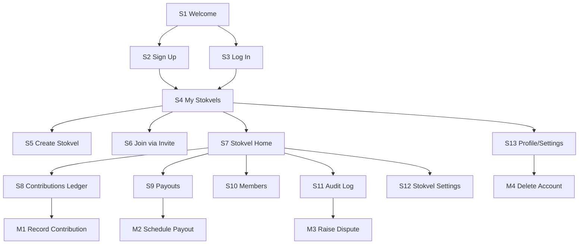

# IMPLEMENTATION_PLAN.md: StokvelOS

---

## 0. Plan details

| Field | Value |
| --- | --- |
| App name | StokvelOS |
| Built from PRD version | v0.6 |
| Screen designs | `docs/designs/STITCH_PROMPTS.md` (S1–S13, M1–M7). Stitch project URL: https://stitch.google.com/projects/9928979343368528728 |
| Plan version | v1.7 |
| Repository | https://github.com/ThamiSithole/stokvelos |
| Status | Phase 2 unblocked — all §18 clarifications closed; awaiting hosted Supabase credentials and the human's "Start Phase 2" |
| Last updated | 23 Nov 2026 |

---

## 1. Start here (instructions for the coding agent)

Before writing any code:

1. Read this whole file from top to bottom.
2. Read `docs/PRD.md`.
3. Look at the screen designs listed in Section 7.3 (`docs/designs/STITCH_PROMPTS.md`).
4. Check Section 18. If any clarification marked **Blocking** for the phase you are about to start is still **Open**, stop and ask the human. Do not start that phase.
5. Check that the prerequisites in Section 4.2 are installed.
6. Start **Phase 2 only**. Phase 1 (M1 scaffolding) is already complete. Follow Section 2 at all times.

---

## 2. Rules for the coding agent (copy word for word, do not edit)

1. **One phase at a time.** Only work on the phase the human asked for. When that phase's Definition of Done is complete, stop and wait for the human to say "Start Phase <number>".
2. **Test-driven development (TDD) for every task.** Follow the cycle in Section 12.1:
    - Write the test.
    - Run it and see it fail for the right reason.
    - Write the smallest code that makes it pass.
    - Run all tests.
    - Refactor while all tests still pass.
3. **Never cheat a test.** Never delete, skip, weaken or change a test just to make it pass. If you believe a test is wrong, stop and explain why to the human.
4. **Never break earlier work.** Every test from earlier phases must still pass before a phase is done.
5. **Build only what is planned.** Build only what is in this file and `docs/PRD.md`. Never build anything in Section 3.3 (Deferred).
6. **Ask, don't guess.** If anything is missing, unclear or contradictory, stop, add it to Section 18, and ask the human.
7. **Match the designs.** Every screen must match its design in Section 7.3: layout, order, labels, text, colours and spacing. Use the design tokens in Section 7.1. Never hard-code colours, font sizes or spacing.
8. **Every state, every screen.** Each screen must handle every state listed for it in Section 7.3 (chosen from normal, empty, loading, error, offline, success, plus any screen-specific states).
9. **Exact wording.** Use the exact labels and messages from the PRD. Never invent wording.
10. **Security first.**
    - Never put secret keys in app code, logs, test files or Git.
    - Every permission rule in Section 9 must be enforced on the server or database, never only in the app.
    - Every permission rule must have a test.
11. **Full check before "done".** Run the full check command (Section 4.3) before saying a phase is done, then add a short summary of the results to the Progress log (Section 17).
12. **Record your progress.** After each phase:
    - tick the checkboxes for that phase in this file;
    - add a row to the Progress log;
    - commit using the commit message given in the phase.
13. **No surprise libraries.** Do not add, remove or upgrade any library or tool not listed in Section 4.1 without asking the human first.
14. **Stuck rule.** If the same problem is still failing after 3 attempts, stop and report:
    - what you tried;
    - the exact error;
    - what you need from the human.
15. **Clean code.** Follow the folder structure in Section 5. Use the PRD's key terms (Section 3.4) for names in code. Keep files small and focused.

---

## 3. Project summary and scope

### 3.1 Summary

StokvelOS is a mobile-first, low-data web app (PWA) for South African stokvels. It gives a group a shared, tamper-evident ledger: create a stokvel, invite members, record contributions, schedule and track payouts, and keep an immutable audit trail. No money is held or moved by the app in v1 — it is a record-keeping and trust tool, not a bank.

**Platform:** Responsive web app (PWA), mobile-first. Android Chrome first; desktop supported. No native app in v1.

### 3.2 Features in scope

| ID | Feature | Priority | Goal | Built in phase |
| --- | --- | --- | --- | --- |
| F1 | Accounts & roles | Must | G3, G5 | 2 |
| F2 | Stokvel groups | Must | G5 | 2 |
| F3 | Contributions ledger | Must | G1, G2, G4 | 3 |
| F4 | Payout schedule & tracking | Must | G2, G4 | 4 |
| F5 | Audit & dispute log | Must | G1, G3 | 5 |
| F6 | Reminders & notifications | Should | G2, G4 | 6 |
| F7 | Export & reports | Should | G4 | 6 |
| F8 | Offline & low-data | Should | G5 | 6 |

MVP = F1–F5. F6–F8 are polish.

### 3.3 Deferred: do NOT build

- Holding or moving money; custody of funds in any form (PRD 3.2).
- Banking, interest, lending or multi-currency/cross-border features (PRD 3.2).
- Automated bank reconciliation and payment-gateway payouts (v2 — PayFast vs Yoco; see PRD §14 open questions).
- Push notifications at scale (in-app notifications + WhatsApp share links only in v1).
- Native mobile apps / iOS app (PRD 3.2, 4.3).
- Full payment gateway, stokvel association white-label, multi-group dashboards (PRD 4.3).
- Vernacular UI languages in v1 — English only with an i18n-ready string structure; all 12 South African official languages are a future feature (§18 C12 closed).
- Platform Admin moderation UI — no admin screen in v1; the role is an `is_admin` boolean on `profiles` (§18 C2 closed).

### 3.4 Key terms (use these names in code)

| Term (PRD 1.7 / 15) | Name in code | Meaning |
| --- | --- | --- |
| Stokvel | `Stokvel`, table `stokvels` | A rotating savings & credit association |
| Organizer (Treasurer) | role value `organizer` in `stokvel_members.role` | Creates and administers a stokvel |
| Member | role value `member` in `stokvel_members.role` | A participant in a stokvel |
| Contribution | `Contribution`, table `contributions` | A recorded payment by a member for a period |
| Payout | `Payout`, table `payouts` | A scheduled or completed payment out per rotation |
| Cycle | `period_label` on contributions | One full rotation where every member receives one payout |
| Audit log | `AuditLog`, table `audit_log` | Immutable record of every change (who, what, when, before/after) |
| Dispute | `Dispute`, table `disputes` | Member-raised question about a contribution or payout |
| Platform Admin | `is_admin` boolean on `profiles` (§18 C2 closed) | Moderate, aggregate stats, suspend abusive accounts |

---

## 4. Tech stack, prerequisites and commands

### 4.1 Stack

| Layer | Tool | Version | Used for |
| --- | --- | --- | --- |
| Frontend | Next.js App Router | 15.5.29 | Screens, routes, server components |
| Language | TypeScript (strict) | ^5 | All app, test and script code |
| Styling | Tailwind CSS + shadcn/ui (`components.json`) | 4.3.3 | Design tokens and shared components |
| Icons | lucide-react | 0.469.0 | Outlined icons (PRD 9.4) |
| Backend and database | Supabase: PostgreSQL, Auth, RLS | supabase-js ^2.47.10 | Data, login, permissions |
| Supabase SSR helper | `@supabase/ssr` | ^0.5.2 | Browser/server clients (`src/lib/supabase/`) |
| Database migrations | Supabase CLI + SQL migrations | Latest CLI | Tables, RLS, triggers, seed |
| Database tests | pgTAP via `supabase test db` | Supabase CLI | Constraints, triggers, RLS (§9) |
| Integration tests | Vitest + supabase-js against local Supabase | ^2.1.8 | Operations (§10) |
| Offline cache | Workbox service worker | latest stable (confirm version at install) | Read-only cache + staleness banner (§18 C13) |
| Unit and component tests | Vitest + Testing Library + jsdom | ^2.1.8 / ^16.1.0 / ^25 | Rules, components, screen states |
| End-to-end tests | Playwright | ^1.49.1 | User flows (§12.2) |
| Lint and type check | ESLint 8 + `tsc --noEmit` | ^8.57.0 / ^5 | Code quality |
| Hosting | Vercel | — | Production PWA |
| Runtime | Node.js | 20 LTS (as in CI) | Running tools |

Install new Supabase packages via npm. Workbox is explicitly approved by the human for the read-only offline cache (§18 C13 closed); no other library may be added without asking (§2 rule 13).

### 4.2 Prerequisites on the computer

- [ ] Node.js 20 LTS and npm
- [ ] Git and a GitHub account
- [ ] Docker Desktop, running (local Supabase needed for RLS and integration tests)
- [ ] Supabase CLI installed and logged in
- [ ] Accounts: Supabase (local + hosted project), Vercel
- [ ] Playwright browsers installed (`npx playwright install chromium`)
- [ ] A hosted Supabase project with URL, anon key and service-role key (§6)

### 4.3 Commands

| Purpose | Command |
| --- | --- |
| Install dependencies | `npm install` |
| Start the local backend | `npx supabase start` |
| Reset the database (migrations + seed) | `npx supabase db reset` |
| Serve/validate migrations locally | `npx supabase db push --local` |
| Start the app | `npm run dev` |
| Unit and component tests | `npm run test` |
| Database and permission tests | `npx supabase test db` |
| Integration tests | `npm run test:integration` (to be added in Phase 2) |
| End-to-end tests | `npm run test:e2e` |
| Lint | `npm run lint` |
| Type check | `npm run typecheck` |
| Build | `npm run build` |
| **Full check (run before every "done")** | `npm run check` (lint + typecheck + `npm test` + `supabase test db` + `test:integration` + build). `npx supabase start` must be running. |
| Deploy | Vercel (Git push to `main`) |

E2E tests (Playwright) are run at the end of each feature phase and in Phase 7. They are not part of `npm run check` unless the human asks.

---

## 5. Folder structure

```
stokvelos/
  src/
    app/
      page.tsx                          S1 Welcome (exists, placeholder)
      (auth)/sign-up/page.tsx           S2 Sign Up
      (auth)/log-in/page.tsx            S3 Log In
      (app)/layout.tsx                  Auth guard + bottom nav
      (app)/stokvels/page.tsx           S4 My Stokvels
      (app)/stokvels/new/page.tsx       S5 Create Stokvel
      (app)/join/[token]/page.tsx       S6 Join via Invite
      (app)/stokvels/[id]/page.tsx      S7 Stokvel Home
      (app)/stokvels/[id]/ledger/page.tsx     S8 Contributions Ledger
      (app)/stokvels/[id]/payouts/page.tsx    S9 Payouts
      (app)/stokvels/[id]/members/page.tsx    S10 Members
      (app)/stokvels/[id]/audit/page.tsx      S11 Audit Log
      (app)/stokvels/[id]/settings/page.tsx   S12 Stokvel Settings
      (app)/profile/page.tsx            S13 Profile/Settings
      globals.css                       Tailwind + design tokens
    components/
      ui/                               shadcn/ui primitives
      Button.tsx, TextInput.tsx, Card.tsx, Table.tsx, Badge.tsx,
      Banner.tsx, Modal.tsx, EmptyState.tsx, Spinner.tsx,
      TopAppBar.tsx, BottomNav.tsx      Shared components (§7.2)
      modals/                           M1–M7
    lib/
      supabase/client.ts                Browser client (exists)
      supabase/server.ts                Server client (exists)
      api/                              One file per operation (§10)
      rules/                            Pure BR functions, no network
      messages.ts                       Every exact PRD message in one place
      utils.ts                          Helpers (exists)
      __tests__/                        Vitest unit + component tests
  supabase/
    migrations/                          SQL migrations (§8.6)
    tests/                               pgTAP tests (§9, §12.2)
  e2e/                                   Playwright flows (§12.2)
  docs/
    PRD.md
    designs/STITCH_PROMPTS.md            Screen prompts for Stitch
    brand/kit/                           R2-B Refined ledger logo kit
    CHECKIN_SUBMISSION.md
  IMPLEMENTATION_PLAN.md
  BUSINESS.md
  README.md
  .env.example
  .github/workflows/ci.yml
```

**Rule:** a new folder may only be created if it is added to this section first.

---

## 6. Environment variables and secrets

| Name | What it is | Where to get it | Public or secret | Used by |
| --- | --- | --- | --- | --- |
| `NEXT_PUBLIC_SUPABASE_URL` | Supabase project URL | Hosted: Project Settings → API. Local: `http://127.0.0.1:54321` | Public | App, tests |
| `NEXT_PUBLIC_SUPABASE_ANON_KEY` | Publishable (anon) key | Same | Public. Safe only because every table has RLS (§9). | App, tests |
| `SUPABASE_SERVICE_ROLE_KEY` | Admin (service-role) key | Same | **Secret** | Local server-side seed/integration scripts only, via `.env.local`; never in client code, CI or committed test files (§18 C15 closed). |
| `SEED_TEST_PASSWORD` | Password for all seed test accounts | You choose | **Secret** | Local seed script, integration tests, Playwright (§18 C15 closed) |

`.env.example`:

```
NEXT_PUBLIC_SUPABASE_URL=
NEXT_PUBLIC_SUPABASE_ANON_KEY=
SUPABASE_SERVICE_ROLE_KEY=
SEED_TEST_PASSWORD=
```

Rules:

- Real values go in `.env.local`, which matches `.env*` in `.gitignore` and is never committed.
- Only variables starting with `NEXT_PUBLIC_` may be imported in `src/app/`, `src/components/` or `src/lib/supabase/client.ts`. A test fails if `SUPABASE_SERVICE_ROLE_KEY` appears in client code (SEC20). The key is never supplied to GitHub Actions; CI runs secret-free unit/component checks only (§18 C15 closed).
- If a new variable is needed, add it here and to `.env.example` first.

---

## 7. Design system and screens

### 7.1 Design tokens

| Token | Value | From PRD |
| --- | --- | --- |
| `color.primary` | #1b5e20 | 9.1 Primary |
| `color.primaryLight` | #2e7d32 | 9.1 Primary light |
| `color.secondary` | #f9a825 | 9.1 Secondary |
| `color.background` | #fafafa | 9.1 Background |
| `color.surface` | #ffffff | 9.1 Surface |
| `color.text` | #1a1a1a | 9.1 Text primary |
| `color.textSecondary` | #5f6368 | 9.1 Text secondary |
| `color.error` | #c62828 | 9.1 Error |
| `color.success` | #2e7d32 | 9.1 Success |
| `color.warning` | #f9a825 | 9.1 Warning |
| `color.border` | #e0e0e0 | 9.1 Border |
| `color.disabled` | #bdbdbd | 9.1 Disabled |
| `font.family` | Inter, system-ui fallback | 9.2 |
| `font.h1` | 24px / 32px, Bold (700) | 9.2 |
| `font.h2` | 20px / 28px, Semibold (600) | 9.2 |
| `font.h3` | 16px / 24px, Semibold (600) | 9.2 |
| `font.body` | 14px / 20px, Regular (400) | 9.2 |
| `font.caption` | 12px / 16px, Regular (400) | 9.2 |
| `font.button` | 14px / 20px, Medium (500) | 9.2 |
| `font.input` | 14px / 20px, Regular (400) | 9.2 |
| `space.xs` / `space.sm` / `space.md` / `space.lg` / `space.xl` | 4 / 8 / 16 / 24 / 32 px | 9.3 |
| `size.touchMin` | 44px minimum | 9.3 |
| `icon.size` | 24px default, 20px compact | 9.4 |
| `icon.style` | Lucide / Heroicons outlined | 9.4 |
| Logo | R2-B "Refined ledger" (`docs/brand/kit/`) | 9.5 |

Accessibility tokens (PRD 8.4): WCAG AA contrast, ≥44×44px targets, labels on all inputs, body text ≥14px, respect `prefers-reduced-motion`.

### 7.2 Shared components

| Component | File | Variants and states | Used on | Tests |
| --- | --- | --- | --- | --- |
| Button | `src/components/Button.tsx` | Primary, secondary, ghost, destructive, disabled, loading | All | T-C-1 |
| TextInput | `src/components/TextInput.tsx` | Default, focused, error, disabled | S2, S3, S5, S12, S13, M1–M4 | T-C-2 |
| Card | `src/components/Card.tsx` | Stokvel card, stat card, member row | S4, S7, S10 | T-C-3 |
| Table | `src/components/Table.tsx` | Contributions (member × period), totals | S8 | T-C-4 |
| Badge | `src/components/Badge.tsx` | Role (organizer/member), status (paid/scheduled/overdue) | S9, S10 | T-C-5 |
| Banner | `src/components/Banner.tsx` | Alert, info, error, success, staleness | All | T-C-6 |
| Modal/Dialog | `src/components/Modal.tsx` | Form modal, confirm modal | M1–M7 | T-C-7 |
| EmptyState | `src/components/EmptyState.tsx` | Icon + message + CTA | S4, S8, S9, S10, S11 | T-C-8 |
| Spinner | `src/components/Spinner.tsx` | Small (inline), large (full-screen) | All | T-C-9 |
| TopAppBar | `src/components/TopAppBar.tsx` | Title, back, optional action | Detail screens | T-C-10 |
| BottomNav | `src/components/BottomNav.tsx` | 5 tabs: Home, Ledger, Payouts, Audit, Profile | S4, S7, S8, S9, S10, S11, S13 | T-C-11 |

### 7.3 Screens

| ID | Screen | Route / file | Design | Who can open it (else redirect to) | Tab bar | Required states | Phase |
| --- | --- | --- | --- | --- | --- | --- | --- |
| S1 | Welcome | `src/app/page.tsx` | Stitch S1 | Logged out (else S4) | No | Normal | 1 |
| S2 | Sign Up | `src/app/(auth)/sign-up/page.tsx` | Stitch S2 | Logged out (else S4) | No | Normal, Loading, Error, Offline, Success | 2 |
| S3 | Log In | `src/app/(auth)/log-in/page.tsx` | Stitch S3 | Logged out (else S4) | No | Normal, Loading, Error, Offline, Success | 2 |
| S4 | My Stokvels | `src/app/(app)/stokvels/page.tsx` | Stitch S4 | Logged in | Yes | Normal, Empty, Loading, Error, Offline | 2 |
| S5 | Create Stokvel | `src/app/(app)/stokvels/new/page.tsx` | Stitch S5 | Logged in | Yes | Normal, Loading, Error, Offline, Success | 2 |
| S6 | Join via Invite | `src/app/(app)/join/[token]/page.tsx` | Stitch S6 | Logged in | Yes | Normal, Empty, Loading, Error, Offline, Success | 2 |
| S7 | Stokvel Home | `src/app/(app)/stokvels/[id]/page.tsx` | Stitch S7 | Member of that stokvel | Yes | Normal, Loading, Error, Offline | 3 |
| S8 | Contributions Ledger | `src/app/(app)/stokvels/[id]/ledger/page.tsx` | Stitch S8 | Member of that stokvel | Yes | Normal, Empty, Loading, Error, Offline, Success | 3 |
| S9 | Payouts | `src/app/(app)/stokvels/[id]/payouts/page.tsx` | Stitch S9 | Member of that stokvel | Yes | Normal, Empty, Loading, Error, Offline, Success | 4 |
| S10 | Members | `src/app/(app)/stokvels/[id]/members/page.tsx` | Stitch S10 | Member of that stokvel | Yes | Normal, Empty, Loading, Error, Offline, Success | 2 |
| S11 | Audit Log | `src/app/(app)/stokvels/[id]/audit/page.tsx` | Stitch S11 | Member of that stokvel | Yes | Normal, Empty, Loading, Error, Offline | 5 |
| S12 | Stokvel Settings | `src/app/(app)/stokvels/[id]/settings/page.tsx` | Stitch S12 | Organizer of that stokvel | Yes | Normal, Loading, Error, Offline, Success | 2 |
| S13 | Profile/Settings | `src/app/(app)/profile/page.tsx` | Stitch S13 | Logged in | Yes | Normal, Loading, Error, Offline, Success | 6 |
| M1 | Record Contribution | `src/components/modals/RecordContribution.tsx` | Stitch M1 | Organizer (from S8) | — | Normal, Loading, Error, Offline, Success | 3 |
| M2 | Schedule Payout | `src/components/modals/SchedulePayout.tsx` | Stitch M2 | Organizer (from S9) | — | Normal, Loading, Error, Offline, Success | 4 |
| M3 | Raise Dispute | `src/components/modals/RaiseDispute.tsx` | Stitch M3 | Member (from S11) | — | Normal, Loading, Error, Offline, Success | 5 |
| M4 | Delete Account | `src/components/modals/DeleteAccount.tsx` | Stitch M4 | Logged in (from S13) | — | Normal, Loading, Error, Offline, Success | 6 |
| M5 | Invite Member | `src/components/modals/InviteMember.tsx` | Stitch M5 | Organizer (from S10) | — | Normal, Loading, Error, Offline, Success | 2 |
| M6 | Mark Payout Paid | `src/components/modals/MarkPayoutPaid.tsx` | Stitch M6 | Organizer (from S9) | — | Normal, Loading, Error, Offline, Success | 4 |
| M7 | Remove Member | `src/components/modals/RemoveMember.tsx` | Stitch M7 | Organizer (from S10) | — | Normal, Loading, Error, Offline, Success | 2 |

Design source for every row: `docs/designs/STITCH_PROMPTS.md`. Exact layout, labels, messages and sample content are in those prompts (generated from PRD §8.1/§8.2/§9). Do not invent wording.
S2 and S3 include a "Continue with Google" button per PRD §5 and §18 C17; apply the updated Stitch S2/S3 prompts. S13 export is client-side — no Storage bucket.

---

## 8. Data model and database

### 8.1 Tables

**Table: `profiles`**: one person's public profile (PRD 10).

| Column | Type | Null? | Default | Constraints | Notes |
| --- | --- | --- | --- | --- | --- |
| id | uuid | No | — | primary key; foreign key → `auth.users.id` on delete cascade | Created by trigger on sign-up |
| full_name | text | Yes | — | — | PRD: full_name |
| phone | text | Yes | — | — | PRD: phone |
| avatar_url | text | Yes | — | — | PRD: avatar_url |
| created_at | timestamptz | No | now() | — | — |
| is_admin | boolean | No | false | — | Platform Admin flag (§18 C2); never self-settable (SEC2) |

**Table: `stokvels`**: a stokvel group (PRD 10).

| Column | Type | Null? | Default | Constraints | Notes |
| --- | --- | --- | --- | --- | --- |
| id | uuid | No | gen_random_uuid() | primary key | — |
| name | text | No | — | length 1–100 | — |
| description | text | Yes | — | length ≤ 500 | — |
| contribution_amount | numeric(12,2) | No | — | > 0 and ≤ 1,000,000 (BR4) | — |
| contribution_frequency | text | No | — | check in ('weekly','monthly') | PRD 10 |
| currency | text | No | 'ZAR' | — | — |
| rotation_order | jsonb | No | '[]'::jsonb | array of stokvel_members.id | BR11; defaults to join order |
| created_by | uuid | No | — | foreign key → `profiles.id` | Becomes organizer |
| created_at | timestamptz | No | now() | — | — |
| updated_at | timestamptz | No | now() | — | — |

**Table: `stokvel_members`**: membership and role (PRD 10).

| Column | Type | Null? | Default | Constraints | Notes |
| --- | --- | --- | --- | --- | --- |
| id | uuid | No | gen_random_uuid() | primary key | — |
| stokvel_id | uuid | No | — | foreign key → `stokvels.id` on delete cascade | — |
| user_id | uuid | No | — | foreign key → `profiles.id` on delete cascade | — |
| role | text | No | 'member' | check in ('organizer','member') | — |
| status | text | No | 'active' | check in ('active','invited','removed') | — |
| joined_at | timestamptz | No | now() | — | Used as default rotation order (BR11) |
| — | — | — | — | unique (stokvel_id, user_id) | A user may belong to many stokvels (BR13) |

**Table: `invitations`**: invite links (PRD 10, BR6).

| Column | Type | Null? | Default | Constraints | Notes |
| --- | --- | --- | --- | --- | --- |
| id | uuid | No | gen_random_uuid() | primary key | — |
| stokvel_id | uuid | No | — | foreign key → `stokvels.id` on delete cascade | — |
| token | uuid | No | gen_random_uuid() | unique | URL token for S6 |
| invited_by | uuid | No | — | foreign key → `profiles.id` | — |
| invited_email | text | Yes | — | — | Optional |
| expires_at | timestamptz | No | now() + interval '7 days' | — | BR6: 7 days |
| accepted_at | timestamptz | Yes | — | — | BR6: single-use unless reusable |
| reusable | boolean | No | false | — | Organizer-configurable (BR6) |

**Table: `contributions`**: group ledger rows (PRD 10, BR4).

| Column | Type | Null? | Default | Constraints | Notes |
| --- | --- | --- | --- | --- | --- |
| id | uuid | No | gen_random_uuid() | primary key | — |
| stokvel_id | uuid | No | — | foreign key → `stokvels.id` on delete cascade | — |
| member_id | uuid | No | — | foreign key → `stokvel_members.id` | — |
| amount | numeric(12,2) | No | — | > 0 and ≤ 1,000,000 (BR4) | ZAR |
| period_label | text | No | — | length 1–50 | `2026-W47`, `2026-W48`, `Nov 2026` (§18 C14 closed) |
| note | text | Yes | — | length ≤ 500 | — |
| recorded_by | uuid | No | — | foreign key → `profiles.id` | Organizer only (BR2) |
| recorded_at | timestamptz | No | now() | — | — |
| — | — | — | — | unique (stokvel_id, member_id, period_label) | No duplicate for same period (PRD 6.2) |

**Table: `payouts`**: scheduled/completed payouts (PRD 10, BR5, BR7).

| Column | Type | Null? | Default | Constraints | Notes |
| --- | --- | --- | --- | --- | --- |
| id | uuid | No | gen_random_uuid() | primary key | — |
| stokvel_id | uuid | No | — | foreign key → `stokvels.id` on delete cascade | — |
| member_id | uuid | No | — | foreign key → `stokvel_members.id` | — |
| amount | numeric(14,2) | No | — | > 0 and ≤ 10,000,000 (BR5) | ZAR |
| scheduled_date | date | No | — | — | — |
| status | text | No | 'scheduled' | check in ('scheduled','paid','cancelled') | — |
| paid_at | timestamptz | Yes | — | — | Set when marked paid |
| recorded_by | uuid | No | — | foreign key → `profiles.id` | Organizer only (BR2) |
| note | text | Yes | — | length ≤ 500 | — |

**Table: `disputes`**: member-raised questions (PRD 10, BR3, BR10).

| Column | Type | Null? | Default | Constraints | Notes |
| --- | --- | --- | --- | --- | --- |
| id | uuid | No | gen_random_uuid() | primary key | — |
| stokvel_id | uuid | No | — | foreign key → `stokvels.id` on delete cascade | — |
| raised_by | uuid | No | — | foreign key → `profiles.id` | Must be a member (BR3) |
| subject_type | text | No | — | check in ('contribution','payout','stokvel') | — |
| subject_id | uuid | Yes | — | — | Null for 'stokvel' |
| description | text | No | — | length 1–2000 | — |
| status | text | No | 'open' | check in ('open','resolved') | — |
| resolved_by | uuid | Yes | — | foreign key → `profiles.id` | Organizer only (BR10) |
| resolved_at | timestamptz | Yes | — | — | — |
| resolution_note | text | Yes | — | length ≤ 2000 | — |

**Table: `audit_log`**: immutable change history (PRD 10, BR8, BR9).

| Column | Type | Null? | Default | Constraints | Notes |
| --- | --- | --- | --- | --- | --- |
| id | uuid | No | gen_random_uuid() | primary key | — |
| stokvel_id | uuid | No | — | foreign key → `stokvels.id` on delete cascade | — |
| actor_id | uuid | No | — | foreign key → `profiles.id` | Anonymised on account deletion (PRD 12) |
| action | text | No | — | — | "Contribution recorded/updated/deleted", "Payout scheduled/marked paid/cancelled", "Member added/removed", "Stokvel updated", "Dispute raised/resolved" (§18 C8 closed) |
| entity_type | text | No | — | — | e.g. 'contribution', 'payout' |
| entity_id | uuid | No | — | — | — |
| before | jsonb | Yes | — | — | — |
| after | jsonb | Yes | — | — | — |
| created_at | timestamptz | No | now() | — | Chronological feed (S11) |

**Not in v1:** a Platform Admin table or moderation UI (§18 C2 closed — the role is an `is_admin` boolean on `profiles`).

### 8.2 Relationships and delete behaviour

- One profile has many stokvel_members; deleting a user cascades their memberships.
- One stokvel has many stokvel_members, invitations, contributions, payouts, disputes and audit_log rows; deleting a stokvel cascades all of them.
- One stokvel_member has many contributions and payouts; removing a member with an unpaid payout in the current cycle is blocked (BR7).
- One contribution, payout or dispute creates exactly one audit_log row via trigger (BR9).
- A user may belong to multiple stokvels (BR13).
- Deleting an account removes `profiles`; audit_log rows are retained with `actor_id` anonymised (PRD 12). There is no admin deletion path in v1 — self-delete only (§18 C2).

### 8.3 Status changes

| Entity | Field | Values | Who changes it |
| --- | --- | --- | --- |
| stokvel_members | status | active → invited → active; active → removed | Organizer (BR7 guard on removal) |
| invitations | accepted_at | null → timestamp | Join RPC (BR6) |
| payouts | status | scheduled → paid / cancelled | Organizer (BR2) |
| disputes | status | open → resolved | Organizer only (BR10) |
| audit_log | — | immutable | Database triggers only (BR8, BR9) |

### 8.4 Indexes

- `stokvel_members (user_id)`: "my stokvels" list (S4).
- `stokvel_members (stokvel_id, role)`: organizer checks.
- `contributions (stokvel_id, period_label, member_id)`: ledger table (S8).
- `payouts (stokvel_id, scheduled_date)`: upcoming payouts (S9).
- `payouts (member_id, status)`: BR7 removal guard.
- `disputes (stokvel_id, status)`: open disputes.
- `audit_log (stokvel_id, created_at desc)`: chronological feed (S11).
- `invitations (token)` unique: join lookup (S6).

### 8.5 Automatic jobs and triggers

| Name | Runs when | What it does | BR# | Test |
| --- | --- | --- | --- | --- |
| `handle_new_user` | After insert on `auth.users` | Inserts a `profiles` row | — | T-DB-1 |
| `check_stokvel_size` | Before insert on `stokvel_members` | Raises if stokvel would exceed 200 members | BR1 | T-BR1-1 |
| `check_invite_valid` | Inside join RPC | Rejects expired, used or non-reusable invites | BR6 | T-BR6-1 |
| `check_payout_amount` | Before insert/update on `payouts` | Rejects amount ≤ 0 or > 10,000,000 | BR5 | T-BR5-1 |
| `check_contribution_amount` | Before insert/update on `contributions` | Rejects amount ≤ 0 or > 1,000,000 | BR4 | T-BR4-1 |
| `block_member_remove` | Before delete on `stokvel_members` | Blocks removal if unpaid payout in current cycle | BR7 | T-BR7-1 |
| `audit_on_stokvel` | After insert/update on `stokvels` | Writes audit_log row (before/after) | BR9 | T-BR9-1 |
| `audit_on_member` | After insert/update/delete on `stokvel_members` | Writes audit_log row | BR9 | T-BR9-2 |
| `audit_on_contribution` | After insert/update/delete on `contributions` | Writes audit_log row | BR9 | T-BR9-3 |
| `audit_on_payout` | After insert/update/delete on `payouts` | Writes audit_log row | BR9 | T-BR9-4 |
| `audit_on_dispute` | After update on `disputes` | Writes audit_log row on resolve | BR9 | T-BR9-5 |
| `block_audit_write` | Before update/delete on `audit_log` | Raises exception; no app write policy either | BR8 | T-BR8-1 |

### 8.6 Migrations (in order)

1. `0001_tables.sql`: all tables, constraints and indexes in 8.1–8.4.
2. `0002_rls.sql`: RLS enabled on every table; all policies in Section 9.
3. `0003_functions.sql`: join RPC, amount/size/removal guards with `set search_path = ''`.
4. `0004_triggers.sql`: triggers in 8.5.
5. `0005_seed.sql`: seed data in 8.7.
6. `0006_notifications.sql`: in-app notification rows for the five triggers in §10 OP24.

### 8.7 Seed data and test accounts

- **Test accounts:** `nomsa@example.test` (organizer, Nomsa Dlamini, 42, Soweto) and `sipho@example.test` (member, Sipho Nkosi, 30, Tembisa). Password for both from `SEED_TEST_PASSWORD`.
- **Seed stokvels (§18 C3/C16 closed):** "Soweto Savers" — Nomsa Dlamini, 15 members; "Soweto Uplift" — Nomsa Dlamini, 28 members; "Tembisa Together" — burial stokvel in Tembisa, 20 members (PRD 2.3).
- **Seed roster (§18 C3 closed):** generated test data only — `savers01…15@example.test`, `uplift01…28@example.test`, `tembisa01…20@example.test`; no real names, emails or personal data. Counts are cosmetic; functional minimum for tests: 1 organizer + 2 active members in one stokvel, 1 contribution in the current period, 1 scheduled payout, 1 resolved dispute and 5 `audit_log` rows.
- **Seed period labels and payout dates (§18 C14 closed):** R250 weekly / R500 monthly; labels `2026-W47`, `2026-W48`, `Nov 2026`; payout dates `2026-12-05`, `2026-12-12`.
- **Never** use real personal data or real passwords in seed data.

---

## 9. Security and permissions

| ID | Table / resource | Action | Who is allowed | Rule | Enforced by | Tests (allow / deny) |
| --- | --- | --- | --- | --- | --- | --- |
| SEC1 | profiles | read own row | Owner | `id = auth.uid()` | RLS select | T-SEC-1a / 1b |
| SEC2 | profiles | update own row | Owner | Cannot change `id`, `created_at` or `is_admin` | RLS + column privileges | T-SEC-2a / 2b |
| SEC3 | stokvels | read | Members of that stokvel | Exists in `stokvel_members` with status active | RLS select using helper `is_member()` | T-SEC-3a / 3b |
| SEC4 | stokvels | insert | Any logged-in user | Creator becomes organizer | RLS insert + trigger inserts organizer row | T-SEC-4a / 4b |
| SEC5 | stokvels | update / delete | Organizer only | BR2 | RLS using `is_organizer()` | T-SEC-5a / 5b |
| SEC6 | stokvel_members | read | Members of that stokvel | Same as SEC3 | RLS select | T-SEC-6a / 6b |
| SEC7 | stokvel_members | insert | Organizer only | BR1 (2–200 total) | RLS + `check_stokvel_size` | T-SEC-7a / 7b |
| SEC8 | stokvel_members | delete | Organizer only | BR7 unpaid payout guard | RLS + `block_member_remove` | T-SEC-8a / 8b |
| SEC9 | invitations | read | Organizer of that stokvel | BR2 | RLS select | T-SEC-9a / 9b |
| SEC10 | invitations | insert / update | Organizer only | BR6 (7 days, single-use/reusable) | RLS + RPC | T-SEC-10a / 10b |
| SEC11 | contributions | read | Members of that stokvel | SEC3 | RLS select | T-SEC-11a / 11b |
| SEC12 | contributions | write | Organizer only | BR2, BR4, unique period | RLS + DB constraint | T-SEC-12a / 12b |
| SEC13 | payouts | read | Members of that stokvel | SEC3 | RLS select | T-SEC-13a / 13b |
| SEC14 | payouts | write | Organizer only | BR2, BR5 | RLS + DB constraint | T-SEC-14a / 14b |
| SEC15 | disputes | read | Members of that stokvel | BR3 | RLS select | T-SEC-15a / 15b |
| SEC16 | disputes | insert | Member of that stokvel | BR3 | RLS insert with check | T-SEC-16a / 16b |
| SEC17 | disputes | resolve (update) | Organizer of that stokvel | BR10 | RLS update | T-SEC-17a / 17b |
| SEC18 | audit_log | read | Members of that stokvel | BR8, BR9 | RLS select; no write policy | T-SEC-18b (deny only) |
| SEC19 | join RPC | call | Any logged-in user with valid token | BR6 | Function code, `security definer`, `set search_path = ''` | T-SEC-19a / 19b |
| SEC20 | secrets | use | Local server-side seed/integration scripts via env only; never client, CI or committed test files | `NEXT_PUBLIC_` only in client | Test scans client and CI config for service-role key | T-SEC-20b (deny only) |
| SEC21 | Platform Admin | moderate / aggregate stats | `profiles.is_admin = true`, DB-set only, no screen | No read of member financial data beyond aggregates; no impersonation | RLS helper `is_admin()` + SEC2 deny | T-SEC-21a / 21b |

**Always-on security checks** (tested in Phase 7):

- [ ] T-DB-6: a database test lists every table in `public` and fails if any has RLS switched off.
- [ ] Input is checked in the app **and** in the database (constraints in 8.1).
- [ ] Every helper function (`is_member`, `is_organizer`) has `set search_path = ''`.
- [ ] No passwords, tokens or emails are written to logs.
- [ ] A secret scan finds no keys in the repository.
- [ ] Only `NEXT_PUBLIC_` variables may be used in client code (SEC20).

---

## 10. Backend operations

All operations live in `src/lib/api/`. Each returns either data or one of the exact messages in `src/lib/messages.ts`.

| ID | Operation | Who can call it | Input | Output | Rules | Errors (exact message) | Built as | Tests |
| --- | --- | --- | --- | --- | --- | --- | --- | --- |
| OP1 | Sign up | Anyone logged out | email, password, age checkbox, privacy checkbox **or** Google OAuth account (age + privacy consent still required) | Account created; logged in | PRD §5; 18+; ≥8 chars + 1 number for password sign-up | "This email already has an account." | Supabase Auth `signUp` / `signInWithOAuth('google')` | T-US1-1, T-AUTH-2 |
| OP2 | Log in | Anyone logged out | email, password **or** Google OAuth | Session | PRD §5 | "Invalid credentials." / "Please verify email." | Auth `signInWithPassword` / `signInWithOAuth('google')` | T-US2-1, T-AUTH-2 |
| OP3 | Log out | Logged in | — | Session cleared → S1 | PRD §5 | — | Auth `signOut` | T-US3-1 |
| OP4 | Request password reset | Anyone | email | Same message regardless of account | Never reveals account existence | "If an account exists, a reset link has been sent." (§18 C5 closed) | Auth `resetPasswordForEmail` | T-AUTH-1 |
| OP5 | Delete account | Logged in (self) | — | Profile removed; audit_log anonymised | PRD §5, §12 | "Couldn't save." | Server action + DB function | T-M4-1 |
| OP6 | Update profile | Logged in (self) | full_name, phone | Profile saved | SEC2 | "Couldn't save." | Table update | T-S13-1 |
| OP7 | Create stokvel | Logged in | name, description, contribution_amount, frequency, rotation default | Stokvel created; creator = organizer | BR1, BR4, BR11 | Validation errors inline | Table insert + trigger | T-US4-1 |
| OP8 | Update stokvel settings | Organizer | name, amount, frequency, rotation | Saved | BR2, BR11 | Validation errors inline | Table update | T-S12-1 |
| OP9 | Delete group | Organizer | stokvel_id | Group deleted | BR2 | Inline confirm: "Delete [Stokvel]? All contributions, payouts and disputes will be removed. This cannot be undone." (§18 C4 closed) | Table delete (cascade) | T-S12-2 |
| OP10 | Create invitation | Organizer | stokvel_id, invited_email?, reusable | Link, expiry 7 days | BR6 | Validation errors inline | Table insert | T-US5-1 |
| OP11 | Join via invite | Logged in | token | Membership created → S7 | BR1, BR6, BR13 | "This invite has expired. Ask the organizer for a new link." / "This invite has already been used." / "Couldn't join. Try again." | RPC `join_invite` | T-US6-1 |
| OP12 | List members | Member of stokvel | stokvel_id | Member rows with role + join dates | SEC6 | "Couldn't load. Try again." | Select | T-S10-1 |
| OP13 | Invite member | Organizer | stokvel_id | Link + WhatsApp (`wa.me`) share + copy | BR6 | "No connection." | OP10 + share URL | T-M5-1 |
| OP14 | Remove member | Organizer | stokvel_member_id | Member removed | BR7 | "Cannot remove: [Member] has an unpaid payout. Reassign first." | Table delete + trigger | T-M7-1 |
| OP15 | Set rotation order | Organizer | stokvel_id, ordered member IDs | Order saved; default = join order | BR11 | "Only the organizer can do this." | Table update | T-US9-1 |
| OP16 | Record contribution | Organizer | member, amount, period, note | Contribution saved + audit row | BR2, BR4 | "Amount must be between R0.01 and R1,000,000." / "A contribution for [Member] for [Period] already exists. Edit instead?" | Table insert + trigger | T-US7-1 |
| OP17 | View ledger / member statement | Member of stokvel | stokvel_id, member filter? | Table by member × period, totals; own statement | SEC11, BR13 | "Couldn't load. Try again." | Select | T-US8-1 |
| OP18 | Schedule payout | Organizer | member, amount, date, note | Payout created + audit row + notification | BR2, BR5, BR11 | Validation errors inline | Table insert + trigger | T-US10-1 |
| OP19 | Mark payout paid | Organizer | payout_id, paid_at, note | `paid_at` set, status = paid, audit row | BR2 | "Only the organizer can do this." | Table update + trigger | T-US10-2 |
| OP20 | Raise dispute | Member of stokvel | subject + description | Dispute created (open) + organizer notified | BR3 | "Only members can raise a dispute." | Table insert + trigger | T-US12-1 |
| OP21 | Resolve dispute | Organizer | dispute_id, resolution note | status = resolved, resolved_by, resolved_at | BR10 | "Only the organizer can do this." | Table update + trigger | T-US13-1 |
| OP22 | View audit log | Member of stokvel | stokvel_id | Chronological feed (actor, action, before/after, timestamp) | BR8, BR9, SEC18 | "Couldn't load. Try again." | Select | T-US11-1 |
| OP23 | Export ledger | Organizer | stokvel_id, format (PDF/CSV) | File download | G4 | "Couldn't export. Try again." | Client-side generation | T-US14-1 |
| OP24 | Get in-app notifications | Recipient per PRD 4.5 | — | Notification list with exact text | PRD §4.5 | "Couldn't load. Try again." | Select from notifications | T-NOTIF-1 |
| OP25 | Cache group data / staleness | Logged in | group id | Cached data + staleness banner | BR12; >24h stale | "No cached data. Connect to the internet to load." / "Showing cached data from [time]. May be out of date." | Workbox service worker, read-only cache (§18 C13 closed) | T-US15-1 |

---

## 11. Navigation rules

- **Logged out:** can only open S1, S2, S3. Any other route → S1.
- **Logged in:** opening S1, S2 or S3 → S4.
- **Logged in, no stokvels:** S4 shows empty state with Create + Join CTAs.
- **Stokvel detail screens (S7–S12):** only members of that stokvel; otherwise S4 with "Only the organizer can do this." for organizer-only actions (BR2).
- **S12 Stokvel Settings and organizer actions:** organizer only (BR2).
- **Tabs:** S4 Home, S8 Ledger, S9 Payouts, S11 Audit, S13 Profile. Tapping the active tab scrolls to the top.
- **Back button:** closes modals; goes back one screen; on a tab root it leaves the group.
- **Login expired:** "Please log in again." → S3.
- **Bottom nav:** not shown on S1, S2, S3.

Navigation map (copied from PRD 7):



---

## 12. Testing strategy

### 12.1 The TDD cycle (every task, every phase)

1. **Red:** write one test for the behaviour, using the acceptance criterion or rule. Run it. It must **fail**, and fail for the expected reason (e.g. "screen not found", not "syntax error").
2. **Green:** write the **smallest** amount of code that makes that test pass. Run **all** tests.
3. **Refactor:** clean up names, remove duplication, move code to the right folder. Run all tests again. They must still pass.
4. Repeat for the next test.

### 12.2 Test levels

| Level | What it proves | Tool | Folder | Command |
| --- | --- | --- | --- | --- |
| Unit | Business rules and helper functions give the right answers | Vitest | `src/lib/__tests__/` | `npm run test` |
| Component | Each component and screen shows the right things in every state, with fake data | Vitest + Testing Library; `lib/api` mocked | `src/lib/__tests__/` | `npm run test` |
| Database and permissions | Constraints, triggers and permission rules allow and deny the right people | pgTAP | `supabase/tests/` | `npx supabase test db` |
| Integration | Each backend operation works against the real local backend | Vitest + supabase-js | `tests/integration/` (add to §5 in Phase 2) | `npm run test:integration` |
| End-to-end | Whole user flows work in a real browser | Playwright | `e2e/` | `npm run test:e2e` |
| Manual | Screens match designs; real-device checks | Human | Step 5 of each phase | — |

### 12.3 Test IDs

Every automated test name starts with its ID, for example `it('T-US7-1 Records a contribution and writes an audit row.', …)`. Run one test with `npm run test -- -t "T-US7-1"`.

| Prefix | Comes from |
| --- | --- |
| T-US#-# | PRD acceptance criteria (Section 6.1) |
| T-BR#-# | Business rules (PRD 4.4) |
| T-SEC-#a / b | Section 9 permission rules, allow / deny |
| T-SETUP-# | Phase 1 tool and setup checks |
| T-AUTH-# | Account rules (PRD Section 5) |
| T-DB-# | Triggers and constraints not covered by a BR |
| T-NAV-# | Navigation rules (Section 11) |
| T-S#-# / T-M#-# | Extra states or behaviour of one screen or modal |
| T-C-# | Section 7.2 components |
| T-INT-# | Operations not covered by a T-US test |
| T-EDGE-# | PRD 6.2 edge cases |
| T-E2E-# | PRD 7 flows |
| T-NFR-# | PRD 8.4 / 12 / 14 quality requirements |
| T-REL-# | Release checks (Phase 7) |

The same ID may be used at two levels when both prove the same criterion.

### 12.4 Test data rules

- Tests never depend on each other or on the order they run in.
- pgTAP tests run inside a transaction and roll back; each starts from the seed data.
- Integration tests create their own users with random emails and delete them at the end.
- Component tests use fake data from the PRD sample data set, never real network calls.
- No real personal data or real passwords are used anywhere in tests.

### 12.5 Coverage rules

- 100% of PRD acceptance criteria (T-US…) have an automated test, or a manual check where automation is not possible (marked "manual").
- 100% of business rules have unit or database tests.
- 100% of permission rules have an allow test and a deny test, except deny-only rules (SEC18, SEC20).
- 100% of PRD edge cases have a test.
- At least 80% line coverage for `src/lib/rules/` and `src/lib/api/`.

---

## 13. Phases

### 13.0 Phase overview

| Phase | Milestone | Name | Features | Screens | Main tests |
| --- | --- | --- | --- | --- | --- |
| 1 | M1 | Foundation | — | S1 | T-SETUP-1–4, T-C-1–11, T-S1-1 |
| 2 | M2 | Groups, RLS & auth | F1, F2 | S2, S3, S4, S5, S6, S10, S12, M5, M7 | T-US1–6, T-BR1, BR6, BR13, T-SEC-1–10, 19–20 |
| 3 | M3 | Contributions | F3 | S7, S8, M1 | T-US7, US8, T-BR4, BR9, T-SEC-11–12 |
| 4 | M4 | Payouts | F4 | S9, M2, M6 | T-US9, US10, T-BR5, BR7, BR11, T-SEC-13–14 |
| 5 | M5 | Audit & disputes | F5 | S11, M3 | T-US11–13, T-BR3, BR8, BR10, T-SEC-15–18 |
| 6 | M6 | Polish | F6, F7, F8 | S13, M4 | T-US14, US15, T-NOTIF-1, T-BR12, T-NFR-1–7 |
| 7 | M7 | Test & deploy | All | All | Full suite on clean install, T-E2E, T-REL |

---

### Phase 1: Foundation (M1) ✅ complete

**Goal:** The app opens on S1 Welcome, matching its design, and every test level has one passing example test.

**Covers:** S1 · Shared components T-C-1–11 · CI.

**Status:** Done — merged in PR #14. Do not redo. Tests and checks below record what was accepted.

**Step 1: Write the failing tests first (Red)**

| Test ID | Level | File | What it checks |
| --- | --- | --- | --- |
| T-SETUP-1 | Unit | `src/lib/__tests__/smoke.test.ts` | Test runner works |
| T-SETUP-2 | E2E | `e2e/smoke.spec.ts` | App launches and shows a page |
| T-C-1–11 | Component | `src/lib/__tests__/` | Each shared component renders its variants/states |
| T-S1-1 | Component | `src/lib/__tests__/Welcome.test.tsx` | S1 shows logo, pitch, "Sign up" and "Log in" |

**Step 2: Backend (Green)** — Supabase client helpers created (`src/lib/supabase/`).

**Step 3: Frontend (Green)** — Next.js 15 + TS + Tailwind 4 + shadcn config + `.env.example` + CI created.

**Step 4: Refactor and full check** — `npm run lint && npm run typecheck && npm run test && npm run build` passed; CI green on PR.

**Step 5: Manual checks (human)** — CI green; PR #14 merged.

**Definition of Done** — ✅ all ticked (PR #14).

**Commit message:** `feat: scaffold M1` / `fix: align scaffold with Next.js 15 and repair lint config` (already applied).

---

### Phase 2: Groups, RLS & auth (M2)

**Goal:** A person can sign up, log in, create a stokvel, invite members, join via link, manage members and edit group settings; every permission rule is enforced in the database and tested.

**Covers:** F1, F2 · Stories US1–US6 · Screens S2, S3, S4, S5, S6, S10, S12 · Modals M5, M7 · Operations OP1–OP4, OP6–OP15 · Rules BR1, BR2, BR6, BR13 · Permissions SEC1–SEC10, SEC19–SEC21 · Google OAuth (§18 C17) · Legal route /privacy.

**Starts when:** Phase 1 is complete and the human says "Start Phase 2". All §18 clarifications are closed; no Open gate remains.

**Standalone content already landed:** the in-app `/privacy` page (`src/app/privacy/page.tsx`) and its component test were delivered ahead of Phase 2 to close the S2 privacy-link decision (Stitch decision 4). It has no Supabase dependency and does not start Phase 2 work. Phase 2 must still wire the S2 privacy checkbox to link to `/privacy`.

**Step 1: Write the failing tests first (Red)**

| Test ID | Level | File | What it checks |
| --- | --- | --- | --- |
| T-AUTH-1 | Unit | `src/lib/__tests__/password.test.ts` | "abcdefg1" passes; "abcdefgh" and "abc1" fail |
| T-AUTH-2 | Component + Integration | `SignUp.test.tsx`, `LogIn.test.tsx`, `auth.int.test.ts` | Google OAuth sign-up and log-in reach S4; age and privacy consent still enforced |
| T-US1-1 | Component + Integration | `SignUp.test.tsx`, `auth.int.test.ts` | Valid form + both checkboxes → account created → S4 |
| T-US2-1 | Component + Integration | `LogIn.test.tsx`, `auth.int.test.ts` | Correct credentials → S4 (empty or list) |
| T-US3-1 | Integration | `auth.int.test.ts` | Log out clears session → S1 |
| T-US4-1 | Component + Integration | `CreateStokvel.test.tsx`, `stokvel.int.test.ts` | Name + amount + frequency → stokvel created, creator = organizer |
| T-US5-1 | Component + Integration | `InviteMember.test.tsx`, `invite.int.test.ts` | Link generated; WhatsApp share + copy present; expires in 7 days (BR6) |
| T-US6-1 | Component + Integration | `JoinViaInvite.test.tsx`, `invite.int.test.ts` | Valid unexpired invite → membership → S7 |
| T-BR1-1 | Database | `supabase/tests/020_rules.test.sql` | Stokvel size 2–200 enforced |
| T-BR6-1 | Integration | `invite.int.test.ts` | Expired / used / non-reusable invites rejected with exact messages |
| T-BR13-1 | Integration | `stokvel.int.test.ts` | A user can belong to multiple stokvels |
| T-S2-1 | Component | `SignUp.test.tsx` | Error "This email already has an account."; offline "No connection." |
| T-S3-1 | Component | `LogIn.test.tsx` | "Invalid credentials." / "Please verify email." |
| T-S4-1 | Component | `MyStokvels.test.tsx` | Empty: "You're not in any stokvel yet. Create one or join with a link." + 2 CTAs; offline cached + staleness |
| T-S5-1 | Component | `CreateStokvel.test.tsx` | Inline validation; "No connection." |
| T-S6-1 | Component | `JoinViaInvite.test.tsx` | Expired/used messages; "Couldn't join. Try again." |
| T-S10-1 | Component | `Members.test.tsx` | Member rows + role badges + join dates; "No members yet. Invite someone." |
| T-S12-1 | Component | `StokvelSettings.test.tsx` | Form saves; "Saved."; validation errors |
| T-M5-1 | Component | `InviteMember.test.tsx` | Link + WhatsApp + copy; success toast |
| T-M7-1 | Component + Integration | `RemoveMember.test.tsx`, `stokvel.int.test.ts` | BR7 block message; organizer removes member |
| T-SEC-1–10a/b | Database + Integration | `040_rls.test.sql`, `stokvel.int.test.ts` | Allow and deny for SEC1–SEC10 |
| T-SEC-19a / 19b | Integration | `invite.int.test.ts` | Join RPC allow valid token; deny invalid/expired |
| T-SEC-20b | Unit | `src/lib/__tests__/secrets.test.ts` | Service-role key absent from client code and CI config |
| T-SEC-21a / 21b | Database + Integration | `040_rls.test.sql`, `admin.int.test.ts` | `is_admin` allows aggregate stats; denies member financial reads and impersonation; user cannot self-set `is_admin` |
| T-DB-1 | Database | `supabase/tests/010_tables.test.sql` | Every table/column in 8.1 exists with right type |

**Step 2: Backend (Green)**

- [ ] Migrations `0001`–`0006` created and applied with `npx supabase db reset`.
- [ ] Auth configured: email + password, 18+ gate, password rules, forgot password, 30-day session.
- [ ] Google OAuth provider configured in Supabase Auth; callback URLs set; `signInWithOAuth('google')` wired (§18 C17).
- [ ] OP1–OP15 implemented in `src/lib/api/`; exact messages in `src/lib/messages.ts`.
- [ ] RLS enabled on every table; all policies in Section 9 enforced.
- [ ] `handle_new_user`, `check_stokvel_size`, `check_invite_valid`, `block_member_remove` and audit triggers installed.
- [ ] `npm run check` and `npm run test:integration` scripts added (§4.3).
- [ ] Service-role key available only via local `.env.local` to seed/integration scripts; absent from client and CI (§18 C15).

**Step 3: Frontend (Green)**

- [ ] Build S2, S3, S4, S5, S6, S10, S12 and modals M5, M7 to match Stitch designs (§7.3).
- [ ] S2/S3 "Continue with Google" buttons match the updated Stitch prompts (§18 C17).
- [ ] Auth guard in `src/app/(app)/layout.tsx` (§11).
- [ ] Bottom nav shown/hidden per §11; all states per §7.3.
- [ ] Design tokens wired into Tailwind/CSS variables (§7.1).

**Step 4: Refactor and full check**

- [ ] Code cleaned up; names use PRD key terms (§3.4).
- [ ] `npm run check` passes (includes all Phase 1 tests).

**Step 5: Manual checks (human)**

- [ ] Sign up → log in → create stokvel → invite → join works in a browser.
- [ ] In Supabase Studio, RLS shows "enabled" on every table.
- [ ] Each screen matches its Stitch design side by side.

**Definition of Done**

- [ ] Every test in Step 1 passes; all Phase 1 tests still pass.
- [ ] Manual checks ticked by the human.
- [ ] Progress log updated.

**Commit message:** `Phase 2: Groups, RLS and auth`

**STOP.** Wait for the human to say "Start Phase 3".

---

### Phase 3: Contributions (M3)

**Goal:** An organizer can record a contribution; the group ledger and member statement are correct; every write creates an immutable audit row.

**Covers:** F3 · Stories US7, US8 · Screens S7, S8 · Modal M1 · Operations OP16, OP17 · Rules BR2, BR4, BR8, BR9 · Permissions SEC11–SEC12.

**Starts when:** Phase 2 is complete and the human says "Start Phase 3". §18 C14 is closed; proceed.

**Step 1: Write the failing tests first (Red)**

| Test ID | Level | File | What it checks |
| --- | --- | --- | --- |
| T-US7-1 | Component + Integration | `RecordContribution.test.tsx`, `contribution.int.test.ts` | Saved + audit row created |
| T-US8-1 | Component + Integration | `Ledger.test.tsx`, `contribution.int.test.ts` | Member sees contributions, payouts received, balance |
| T-BR4-1 | Unit + Database | `amount.test.ts`, `020_rules.test.sql` | R0.01–R1,000,000 enforced; out-of-range rejected with exact message |
| T-BR8-1 | Database | `040_rls.test.sql` | audit_log update/delete blocked |
| T-BR9-1–5 | Database | `020_triggers.test.sql` | Each audited table writes exactly one audit row |
| T-EDGE-1 | Integration | `contribution.int.test.ts` | Duplicate period → "A contribution for [Member] for [Period] already exists. Edit instead?" |
| T-S7-1 | Component | `StokvelHome.test.tsx` | Balance, next payout, recent activity, quick actions; loading/error/offline |
| T-S8-1 | Component | `Ledger.test.tsx` | Table member × period + totals; empty: "No contributions yet. Record the first one."; success: "Contribution recorded." |
| T-M1-1 | Component | `RecordContribution.test.tsx` | Form member/amount/period/note; spinner; success toast |
| T-SEC-11a / 11b | Database + Integration | `040_rls.test.sql`, `contribution.int.test.ts` | Read allow member, deny non-member |
| T-SEC-12a / 12b | Database + Integration | same | Write allow organizer, deny member |

**Step 2: Backend (Green)**

- [ ] OP16, OP17 implemented; unique (stokvel, member, period) enforced.
- [ ] `check_contribution_amount` and all audit triggers installed.
- [ ] SEC11–SEC12 enforced via RLS.

**Step 3: Frontend (Green)**

- [ ] Build S7, S8 and M1 to match Stitch designs; all states per §7.3.

**Step 4: Refactor and full check** — `npm run check` passes with Phases 1–2.

**Step 5: Manual checks (human)** — Ledger table and member statement correct; S7/S8 match designs; audit row appears after recording.

**Definition of Done** — every Step 1 test passes; earlier tests pass; manual checks ticked; Progress log updated.

**Commit message:** `Phase 3: Contributions`

**STOP.** Wait for the human to say "Start Phase 4".

---

### Phase 4: Payouts (M4)

**Goal:** An organizer can set rotation order, schedule payouts and mark them paid; members see upcoming payouts and history; due-payout notifications fire.

**Covers:** F4 · Stories US9, US10 · Screens S9 · Modals M2, M6 · Operations OP18, OP19, OP24 · Rules BR2, BR5, BR7, BR11 · Permissions SEC13–SEC14.

**Starts when:** Phase 3 is complete and the human says "Start Phase 4". All §18 items gating Phase 4 are closed (C7, C10); proceed.

**Step 1: Write the failing tests first (Red)**

| Test ID | Level | File | What it checks |
| --- | --- | --- | --- |
| T-US9-1 | Component + Integration | `Payouts.test.tsx`, `payout.int.test.ts` | Rotation order saved and used for scheduling; default = join order |
| T-US10-1 | Integration | `payout.int.test.ts` | Schedule payout + audit row |
| T-US10-2 | Integration | `payout.int.test.ts` | Mark paid sets `paid_at` + audit row |
| T-BR5-1 | Unit + Database | `amount.test.ts`, `020_rules.test.sql` | R0.01–R10,000,000 enforced |
| T-BR7-1 | Database | `020_triggers.test.sql` | Removal blocked with "Cannot remove: [Member] has an unpaid payout. Reassign first." |
| T-BR11-1 | Integration | `payout.int.test.ts` | Organizer-set order overrides join order |
| T-S9-1 | Component | `Payouts.test.tsx` | Rotation + upcoming + history; "No payouts scheduled yet."; status badges; all states |
| T-M2-1 | Component | `SchedulePayout.test.tsx` | Form member/amount/date/note; success toast |
| T-M6-1 | Component | `MarkPayoutPaid.test.tsx` | Confirm + paid_at + note; success toast |
| T-NOTIF-1 | Component | `Notifications.test.tsx` | "Payout due for [Member] on [Date]." shown to organizer + recipient |
| T-SEC-13a / 13b | Database + Integration | `040_rls.test.sql`, `payout.int.test.ts` | Read allow member, deny non-member |
| T-SEC-14a / 14b | Database + Integration | same | Write allow organizer, deny member |

**Step 2: Backend (Green)** — OP18, OP19, OP24 implemented; `check_payout_amount`, `block_member_remove`, audit triggers; notification rows; SEC13–SEC14 via RLS.

**Step 3: Frontend (Green)** — Build S9, M2, M6 to match Stitch designs; rotation control per §18 C7 decision; all states per §7.3.

**Step 4: Refactor and full check** — `npm run check` passes with Phases 1–3.

**Step 5: Manual checks (human)** — Schedule → mark paid flow works; due notification appears; S9 matches design.

**Definition of Done** — every Step 1 test passes; earlier tests pass; manual checks ticked; Progress log updated.

**Commit message:** `Phase 4: Payouts`

**STOP.** Wait for the human to say "Start Phase 5".

---

### Phase 5: Audit & disputes (M5)

**Goal:** Members can read the immutable audit log and raise disputes; organizers resolve disputes; all five in-app notifications fire with exact PRD text.

**Covers:** F5 · Stories US11, US12, US13 · Screen S11 · Modal M3 · Operations OP20–OP22, OP24 · Rules BR3, BR8, BR9, BR10 · Permissions SEC15–SEC18.

**Starts when:** Phase 4 is complete and the human says "Start Phase 5". All §18 items gating Phase 5 are closed (C8, C10); proceed.

**Step 1: Write the failing tests first (Red)**

| Test ID | Level | File | What it checks |
| --- | --- | --- | --- |
| T-US11-1 | Component + Integration | `AuditLog.test.tsx`, `audit.int.test.ts` | Chronological feed with actor, action, before/after, timestamp |
| T-US12-1 | Component + Integration | `RaiseDispute.test.tsx`, `dispute.int.test.ts` | Open dispute created; organizer notified "New dispute raised in [Stokvel]." |
| T-US13-1 | Component + Integration | `ResolveDispute.test.tsx`, `dispute.int.test.ts` | resolved_by + resolved_at + resolution note; "Your dispute in [Stokvel] was resolved." |
| T-BR3-1 | Database + Integration | `040_rls.test.sql`, `dispute.int.test.ts` | Non-member cannot raise a dispute |
| T-BR10-1 | Database + Integration | same | Only organizer can resolve |
| T-EDGE-2 | Database | `040_rls.test.sql` | Audit tamper attempt blocked (no UI) |
| T-S11-1 | Component | `AuditLog.test.tsx` | Feed + "No activity yet." + loading/error/offline |
| T-M3-1 | Component | `RaiseDispute.test.tsx` | subject + description; success toast |
| T-SEC-15–18a/b | Database + Integration | `040_rls.test.sql`, `audit.int.test.ts` | Allow/deny per Section 9 (SEC18 deny only) |

**Step 2: Backend (Green)** — OP20–OP22 and remaining OP24 notifications; SEC15–SEC18 via RLS.

**Step 3: Frontend (Green)** — Build S11 and M3 to match Stitch designs; all states per §7.3.

**Step 4: Refactor and full check** — `npm run check` passes with Phases 1–4.

**Step 5: Manual checks (human)** — Raise → resolve dispute; audit log read-only in UI and DB; notifications text matches PRD 4.5 exactly.

**Definition of Done** — every Step 1 test passes; earlier tests pass; manual checks ticked; Progress log updated.

**Commit message:** `Phase 5: Audit and disputes`

**STOP.** Wait for the human to say "Start Phase 6".

---

### Phase 6: Polish (M6)

**Goal:** In-app reminders, PDF/CSV export, offline cache with staleness, accessibility and low-data behaviour are complete.

**Covers:** F6, F7, F8 · Stories US14, US15 + PRD §4.5 notifications · Screen S13 · Modal M4 · Operations OP5, OP23–OP25 · Rule BR12 · PRD 4.5, 8.4, 12, 14.

**Starts when:** Phase 5 is complete and the human says "Start Phase 6". All §18 items gating Phase 6 are closed (C6, C11, C12, C13, C17); proceed.

**Step 1: Write the failing tests first (Red)**

| Test ID | Level | File | What it checks |
| --- | --- | --- | --- |
| T-NOTIF-1 | Component | `Notifications.test.tsx` | All five PRD 4.5 messages render exactly |
| T-US14-1 | Component + Integration | `Export.test.tsx`, `export.int.test.ts` | PDF and CSV download of contributions + payouts |
| T-US15-1 | Component + Integration | `Offline.test.tsx`, `cache.int.test.ts` | First load caches group data; offline shows cached; staleness banner |
| T-BR12-1 | Unit + Component | `staleness.test.ts`, `Offline.test.tsx` | Cache >24h marked stale with "Showing cached data from [time]. May be out of date." |
| T-S13-1 | Component | `ProfileSettings.test.tsx` | Name, phone, export, log out, delete account; "Couldn't save." / "No connection." / "Saved." |
| T-M4-1 | Component | `DeleteAccount.test.tsx` | Confirm modal; success toast |
| T-NFR-1 | Unit | `a11y.test.tsx` | WCAG AA contrast, ≥44px targets, labels, body ≥14px |
| T-NFR-2 | Unit | `motion.test.ts` | `prefers-reduced-motion` respected |
| T-NFR-3 | E2E | `e2e/responsive.spec.ts` | Mobile and desktop layouts match designs |

**Step 2: Backend (Green)** — OP23–OP25 implemented; notification rows for all five triggers; no new server library without asking.

**Step 3: Frontend (Green)** — Build S13 and M4 to match Stitch designs; Workbox read-only offline cache from §18 C13 decision; export UI from §18 C6 decision. Export stays client-side — no Supabase Storage bucket (§18 C17 closed).

**Step 4: Refactor and full check** — `npm run check` passes with Phases 1–5.

**Step 5: Manual checks (human)** — Offline with and without cache; stale banner after 24h; export opens as PDF/CSV; keyboard and screen-reader pass on S1–S13.

**Definition of Done** — every Step 1 test passes; earlier tests pass; manual checks ticked; Progress log updated.

**Commit message:** `Phase 6: Polish`

**STOP.** Wait for the human to say "Start Phase 7".

---

### Phase 7: Test & deploy (M7)

**Goal:** The full suite passes on a clean install; the hosted app works end to end with real data; README, check-in submission and release artefacts are updated.

**Covers:** All features · All screens · Section 15 acceptance checklist · Section 16 release checklist.

**Starts when:** Phase 6 is complete and the human says "Start Phase 7".

**Step 1: Write the failing tests first (Red)**

| Test ID | Level | File | What it checks |
| --- | --- | --- | --- |
| T-E2E-1 | E2E | `e2e/onboarding.spec.ts` | Sign up → log in → create stokvel |
| T-E2E-2 | E2E | `e2e/invite.spec.ts` | Invite → join → member sees group |
| T-E2E-3 | E2E | `e2e/contribution.spec.ts` | Record contribution → ledger + audit |
| T-E2E-4 | E2E | `e2e/payout.spec.ts` | Schedule → mark paid → audit |
| T-E2E-5 | E2E | `e2e/dispute.spec.ts` | Raise → resolve → audit immutable |
| T-DB-6 | Database | `supabase/tests/040_rls.test.sql` | Every `public` table has RLS enabled |
| T-NFR-4 | Unit | `src/lib/__tests__/secrets.test.ts` | Secret scan finds no keys |
| T-REL-1 | Manual | — | Clean install: `npm ci` + full check passes |
| T-REL-2 | Manual | — | Hosted live URL works on Android Chrome and desktop |

**Step 2: Backend (Green)** — Hosted Supabase project created; migrations applied; seed loaded; RLS verified.

**Step 3: Frontend (Green)** — Deploy to Vercel; verify live URL; update README live link and test logins.

**Step 4: Refactor and full check** — Full check on clean install; CI green.

**Step 5: Manual checks (human)** — All Section 15 and Section 16 items ticked; check-in submission updated with live link; Loom recorded (later).

**Definition of Done** — every Step 1 test passes; Section 15 and 16 complete; Progress log updated.

**Commit message:** `Phase 7: Test and deploy`

**STOP.** Project complete. Do not start portfolio work until the human asks.

---

## 14. Traceability matrix

| PRD ID / section | Requirement | Plan section | Phase | Test IDs |
| --- | --- | --- | --- | --- |
| PRD 1.2 | One-line pitch | 3.1, S1 | 1 | T-S1-1 |
| PRD 1.7 / 15 | Key terms | 3.4 | All | — |
| PRD 2.4 | Member / Organizer roles | 3.4, 8.1, 9 | 2 | T-SEC-5, 7, 8, 12, 14, 17 |
| PRD 2.4 | Platform Admin | 3.4, 8.1, 9 SEC21, §18 C2 | 7 | T-SEC-2b, T-SEC-21a/b |
| PRD 3.1 | G1 disputes ≤10% | 3.2, Phase 5 | 5 | T-US12, US13 |
| PRD 3.1 | G2 on-time payouts ≥90% | 3.2, Phase 4 | 4 | T-US10 |
| PRD 3.1 | G3 retention ≥85% | 3.2, Phase 2 | 2 | T-US1–3 |
| PRD 3.1 | G4 time saved ≥60% | 3.2, Phase 6 | 6 | T-US14 |
| PRD 3.1 | G5 ≥20 active stokvels | 3.2, Phase 7 | 7 | T-REL-2 |
| F1 / US1–3 | Accounts & roles | 10 OP1–6, 13 Phase 2 | 2 | T-US1–3, T-AUTH-1, T-AUTH-2 |
| F2 / US4–6 | Stokvel groups | 8.1, 10 OP7–15, 13 Phase 2 | 2 | T-US4–6 |
| F3 / US7–8 | Contributions ledger | 10 OP16–17, 13 Phase 3 | 3 | T-US7–8 |
| F4 / US9–10 | Payouts | 10 OP18–19, 13 Phase 4 | 4 | T-US9–10 |
| F5 / US11–13 | Audit & disputes | 8.5, 10 OP20–22, 13 Phase 5 | 5 | T-US11–13 |
| F6 / PRD 4.5 | Reminders | 4.5, 10 OP24, 13 Phase 6 | 6 | T-NOTIF-1 |
| F7 / US14 | Export | 10 OP23, 13 Phase 6 | 6 | T-US14-1 |
| F8 / US15 | Offline | 10 OP25, 13 Phase 6 | 6 | T-US15-1 |
| BR1 | 2–200 members | 8.5, 9 SEC7 | 2 | T-BR1-1 |
| BR2 | Organizer-only writes | 9 SEC5, 7, 8, 10, 12, 14, 17 | 2–5 | T-SEC-5b, 7b, 8b, 10b, 12b, 14b, 17b |
| BR3 | Dispute in own group | 9 SEC16 | 5 | T-BR3-1 |
| BR4 | Contribution ≤R1m | 8.1, 8.5, 10 OP16 | 3 | T-BR4-1 |
| BR5 | Payout ≤R10m | 8.1, 8.5, 10 OP18 | 4 | T-BR5-1 |
| BR6 | Invite 7 days / single-use | 8.1, 9 SEC19, 10 OP10–11 | 2 | T-BR6-1 |
| BR7 | Removal blocked on unpaid payout | 8.5, 9 SEC8, 10 OP14 | 4 | T-BR7-1 |
| BR8 | Audit immutable | 8.5, 9 SEC18, 10 OP22 | 3, 5 | T-BR8-1 |
| BR9 | Audit by triggers only | 8.5, 10 OP16–21 | 3–5 | T-BR9-1–5 |
| BR10 | Organizer resolves disputes | 9 SEC17 | 5 | T-BR10-1 |
| BR11 | Rotation order | 8.1, 10 OP15 | 2, 4 | T-US9-1, T-BR11-1 |
| BR12 | 24h staleness | 10 OP25 | 6 | T-BR12-1 |
| BR13 | Multiple stokvels | 8.1, 9 SEC3 | 2 | T-BR13-1 |
| PRD 2.4 | Roles & Platform Admin | 3.4, 8.1, 9 SEC2/SEC21 | 2, 7 | T-SEC-2b, T-SEC-21a/b |
| PRD 4.5 | Notifications | 10 OP24 | 4–6 | T-NOTIF-1 |
| PRD 5 | Accounts & sign-in | 6, 10 OP1–6, 13 Phase 2 | 2 | T-AUTH-1, T-AUTH-2, T-US1–3 |
| PRD 6.2 | Edge cases | 10 OP11, 16, 18, 25; 13 phases | 2–6 | T-EDGE-1–2 |
| PRD 7 | Flows & nav | 11 | 2–7 | T-NAV-1–5 |
| PRD 8.1–8.3 | Screens, states, components | 7.1–7.3 | All | T-C-1–11, T-S…, T-M… |
| PRD 8.4 | Accessibility | 7.1, Phase 6 | 6 | T-NFR-1–3 |
| PRD 9 | Design values & logo | 7.1 | All | T-C-1–11 |
| PRD 10 | Data model & RLS | 8, 9 | 2 | T-DB-1, T-DB-6 |
| PRD 11 | Integrations | 4.1, 6, 10 OP13, 23 | 2, 6 | T-M5-1, T-US14-1 |
| PRD 12 | Privacy & security | 6, 9, 10 OP5 | 6, 7 | T-M4-1, T-SEC-20b |
| PRD 13 | Milestones | 13.0 | All | — |
| PRD 14 | Acceptance & open questions | 12.5, 15, §18 | 7 | T-E2E, T-REL |
| PRD 16 | Appendix / logo kit | 0, 7.1 | — | — |

---

## 15. Acceptance test checklist

- [ ] Sign up works; 18+ gate and password rules enforced (T-US1-1, T-AUTH-1).
- [ ] Log in works; wrong credentials and unverified email show exact messages (T-US2-1, T-S3-1).
- [ ] Log out clears session and redirects to S1 (T-US3-1).
- [ ] Google OAuth sign-up and log-in work; age and privacy consent still enforced (T-AUTH-2).
- [ ] Platform Admin flag is DB-only and cannot be self-assigned (T-SEC-2b, T-SEC-21a/b).
- [ ] Organizer and Member roles are enforced in RLS, not only in UI (T-SEC-…b).
- [ ] Create stokvel works; creator becomes organizer (T-US4-1).
- [ ] Invite link generated; WhatsApp share and copy work; expires after 7 days or on use (T-US5-1, T-BR6-1).
- [ ] Member joins via valid invite and sees the group (T-US6-1).
- [ ] Record contribution works; ledger and member statement correct (T-US7-1, T-US8-1).
- [ ] Duplicate contribution for same period blocked with exact message (T-EDGE-1).
- [ ] Rotation order set; default is join order (T-US9-1, T-BR11-1).
- [ ] Schedule payout and mark paid work; `paid_at` and audit row recorded (T-US10-1, T-US10-2).
- [ ] Removing member with unpaid payout blocked (T-BR7-1).
- [ ] Audit log read-only; tamper attempt blocked in DB (T-BR8-1, T-EDGE-2).
- [ ] Raise dispute works; only group members can raise (T-US12-1, T-BR3-1).
- [ ] Resolve dispute works; only organizer can resolve (T-US13-1, T-BR10-1).
- [ ] All five in-app notifications show exact PRD 4.5 text (T-NOTIF-1).
- [ ] PDF/CSV export of contributions + payouts works (T-US14-1).
- [ ] Workbox read-only cache shows cached data offline; >24h cache shows staleness banner; no offline writes (T-US15-1, T-BR12-1).
- [ ] All screens S1–S13 and modals M1–M7 implement every state in §7.3.
- [ ] Design tokens match PRD §9; screens match Stitch designs.
- [ ] Responsive: Android Chrome first, desktop supported (T-NFR-3).
- [ ] WCAG AA contrast, ≥44px targets, labels, body ≥14px, reduced motion (T-NFR-1–2).
- [ ] Every table has RLS enabled (T-DB-6).
- [ ] CI runs lint, typecheck, tests and build on every PR.
- [ ] Must features work end to end on the live link with real hosted data.

---

## 16. Final release checklist

- [ ] Hosted Supabase project created; all migrations applied; seed data loaded.
- [ ] `.env.local` values set locally; `.env*` ignored; no secrets in Git (T-NFR-4).
- [ ] Vercel deployed; live URL in README and `docs/CHECKIN_SUBMISSION.md`.
- [ ] Test logins documented in README (from `SEED_TEST_PASSWORD`).
- [ ] Stitch design exports (or links) present in `docs/designs/`.
- [ ] Logo kit present at `docs/brand/kit/`; wordmark outlined to paths before final delivery (PRD 9.5).
- [ ] Full check passes on clean install (T-REL-1).
- [ ] All sections of `docs/CHECKIN_SUBMISSION.md` completed for final submission.
- [ ] Loom link recorded (final submission field) — later.
- [ ] Portfolio site deferred; not part of this release.

---

## 17. Progress log (the coding agent updates this)

| Date | Phase | What was done | Check result | Commit / PR |
| --- | --- | --- | --- | --- |
| 2026-11-23 | 1 | Next.js 15 + TS + Tailwind + shadcn config, Supabase helpers, Vitest, Playwright, CI, docs, issues | lint, typecheck, test, build pass; CI green | PR #13, PR #14 |
| 2026-11-23 | — | PRD ↔ plan gap closure, persona languages, logo concept, Stitch prompts | PRs merged | PR #18, #19, #20, #21 |
| 2026-11-23 | — | Plan rewritten to standard 19-section template | Merged | PR #22 |
| 2026-11-23 | — | PRD aligned to Indlela format (v0.2); feature-to-screen mapping corrected; incorrect §18 cross-refs fixed | ID-level gap check passed | — |
| 2026-11-23 | — | Stitch project link added to docs; 15:30 check-in submission written | Links verified | — |
| 2026-11-23 | — | Cross-document re-audit: US13 remapped to F5; F6 traces to PRD §4.5; notification test renamed T-NOTIF-1; M4/OP5/T-M4-1 moved out of Phase 2 into Phase 6; BR2 test refs made explicit | ID, ref and phase checks pass | — |
| 2026-11-23 | — | Human answered all 14 Stitch prompt questions; answers recorded in STITCH_PROMPTS.md; 10 §18 clarifications closed; PRD §4.5 S5 → S4 | Cross-doc refs verified | — |
| 2026-11-23 | — | Human supplied the nine remaining privacy-policy inputs; in-app `/privacy` POPIA policy page and component test created; S2 link target closed in STITCH_PROMPTS.md | typecheck, lint, 4 tests, build pass; /privacy prerendered | — |
| 2026-11-23 | — | Human closed the five remaining plan clarifications: C2 `is_admin` flag; C12 English-only i18n-ready; C13 Workbox read-only cache; C15 service-role local-only; C17 OAuth added to Phase 2 with client-side export. PRD v0.6 / plan v1.6; S2/S3 Stitch prompts updated | Cross-doc ID and ref checks pass | — |
| 2026-11-23 | — | Human chose generated `example.test` rosters for C3; C16 group names/counts and C14 labels/dates recorded in §8.7; stale "Open" references and all phase-gate wording cleared; plan v1.7 | No §18 clarification remains Open | — |
| — | 2 | Not started | — | — |
| — | 3 | Not started | — | — |
| — | 4 | Not started | — | — |
| — | 5 | Not started | — | — |
| — | 6 | Not started | — | — |
| — | 7 | Not started | — | — |

---

## 18. Clarifications needed

| ID | Question | Section | Blocking | Status |
| --- | --- | --- | --- | --- |
| C1 | What is the Stitch project URL for the exported designs? | 0, 7.3 | None (resolved) | Closed — https://stitch.google.com/projects/9928979343368528728 |
| C2 | How is the Platform Admin role stored (table/flag), and is a moderation screen in v1? | 3.4, 8.1, 9 SEC21 | None (closed) | Closed — `is_admin` boolean on `profiles`, set only in Supabase; no moderation screen in v1. SEC2 blocks self-assignment; T-SEC-21a/21b |
| C3 | Exact seed data: stokvel names, full member rosters and email addresses. | 8.1, 8.7, 13 Phase 2 | None (closed) | Closed — C16 names/counts (Soweto Savers 15, Soweto Uplift 28, Tembisa Together 20); generated `example.test` members only, no real personal data; C14 labels/dates. All §18 clarifications now closed |
| C4 | Exact delete-group confirmation copy and button label on S12 (PRD lists "delete group" but no modal). | 10 OP9, 13 Phase 2 | Phase 2 | Closed — inline confirm on S12: "Delete [Stokvel]? All contributions, payouts and disputes will be removed. This cannot be undone." / Cancel / Delete stokvel (Stitch Q7) |
| C5 | Exact forgot-password label, destination screen and message copy (PRD 8.1 says "forgot password link", no screen listed). | 5, 10 OP4 | Phase 2 | Closed — "Forgot password?" → inline reset form on S3; "If an account exists, a reset link has been sent." (Stitch Q5) |
| C6 | Should S13 export be one "Export" action with a format choice, or separate PDF and CSV actions? | 10 OP23, 13 Phase 6 | Phase 6 | Closed — one "Export" action with PDF / CSV format choice (Stitch Q14) |
| C7 | Exact rotation-order control on S5/S9/S12 (numbered list, drag handles, etc.). | 8.1/8.2, 13 Phase 4 | Phase 4 | Closed — numbered rows with ↑/↓ buttons, optional drag handle; default join order (Stitch Q10) |
| C8 | Exact audit action labels and before/after formatting for the S11 feed. | 8.1, 10 OP22 | Phase 5 | Closed — labels "Contribution recorded/updated/deleted" etc.; `field: old → new`, newest first (Stitch Q9) |
| C9 | Exact success banner text after S2 sign-up ("Created → S3 banner" — message not specified). | 8.2, 13 Phase 2 | Phase 2 | Closed — "Account created." (Stitch Q11) |
| C10 | Where exactly the PRD §4.5 banners should appear. Their current "Opens" targets are S9, S7, S5, S13, S13 — confirm or correct S5 before building. | 7.3, 13 Phases 4–5 | Phase 4 | Closed — payout due S9, overdue S7, new member joined S4 (corrected from S5), disputes S13/S13; PRD §4.5 updated (Stitch Q12) |
| C11 | Which Lucide glyphs to use for bottom nav tabs and empty-state icons (style/size specified, glyphs not). | 7.1, 7.2 | Phase 2 | Closed — Lucide outlines: Home, ReceiptText, CalendarDays, ScrollText, User; empty states Inbox, Users, CalendarPlus, Receipt, ShieldCheck (Stitch Q13) |
| C12 | Vernacular languages in v1? | 3.3, 4.1 | None (closed) | Closed — English only in v1 with an i18n-ready string structure; all 12 South African official languages are a future feature with a separate i18n budget. No new dependency; no Stitch regeneration |
| C13 | Offline cache strategy: Workbox service worker vs manual IndexedDB. | 4.1, 10 OP25, 13 Phase 6 | None (closed) | Closed — Workbox service worker, read-only cache with staleness banner, no offline writes. Human approval for the library is recorded in §4.1; wrong C11 refs fixed in OP25 and Phase 6 |
| C14 | Exact sample contribution amounts, period labels and payout dates for S8/S9 tables, M1/M2 and seed data. | 8.1, 8.7 | Phase 3 | Closed — R250 weekly / R500 monthly; 2026-W47, 2026-W48, Nov 2026; payout dates 2026-12-05, 2026-12-12 (Stitch Q2) |
| C15 | May the service-role key be used in integration/seed scripts, or should those use an admin RPC? | 6, 9 SEC20, 13 Phase 2 | None (closed) | Closed — local server-side seed/integration scripts only via `.env.local`; never client, CI or committed test files. CI stays secret-free; `SEED_TEST_PASSWORD` added to `.env.example` |
| C16 | Exact stokvel names for the sample cards in S4/S6 (PRD gives member counts and locations only). | 8.7 | Phase 2 | Closed — "Soweto Savers" (15), "Soweto Uplift" (28), "Tembisa Together" (20) (Stitch Q3) |
| C17 | Are Google OAuth and Supabase Storage for exports needed in v1? | 4.1, 6, 7.3, 10 OP1–2, 13 Phases 2/6 | None (closed) | Closed — Google OAuth YES, built in Phase 2 (S2/S3 gain "Continue with Google"; age + privacy consent still apply). Supabase Storage NO — client-side export retained per PRD 11 and OP23 |

If a clarification marked **Blocking** is still Open when you reach that phase, stop and ask the human. Do not guess.

---

## 19. Change log

| Version | Date | Section(s) changed | What changed |
| --- | --- | --- | --- |
| v1.7 | 2026-11-23 | 0, 8.1, 8.7, 13 Phases 2–5, 17, 18 C3, 19 | Closed C3 with generated `example.test` rosters, C16 group names/counts and C14 period labels/payout dates; replaced stale "Open" references for C8/C14/C16 and cleared all phase-gate wording; no §18 item remains Open. | 0, 3.3, 3.4, 4.1, 6, 7.3, 8.1, 8.2, 9 SEC2/SEC20/SEC21, 10 OP1–2/OP4/OP9/OP25, 13 Phases 2/6, 14, 15, 17, 18 C2/C12/C13/C15/C17, 19 | Closed the final five clarifications: `is_admin` flag with no admin screen; English-only i18n-ready with all SA official languages as a future feature; Workbox read-only cache; service-role local-only; Google OAuth added to Phase 2 while Storage stays client-side. Added T-AUTH-2 and T-SEC-21a/b, expanded Phase 2 scope/gates, fixed wrong C11 refs and stale OP4/OP9 error copy, and corrected C17 section refs. PRD bumped to v0.6. |
| v1.5 | 2026-11-23 | 0, 13 Phase 2, 17, 19 | Added the standalone in-app `/privacy` POPIA policy page and its test to close Stitch decision 4; Phase 2 now notes the S2 link wiring still to do; PRD bumped to v0.5. |
| v1.4 | 2026-11-23 | 0, 17, 18 C4–C11/C14/C16, 19 | Recorded all 14 human-confirmed Stitch design answers and closed the 10 matching §18 clarifications (C4, C5, C6, C7, C8, C9, C10, C11, C14, C16) with pointers to `docs/designs/STITCH_PROMPTS.md`; PRD §4.5 notification target corrected to S4; PRD bumped to v0.4. |
| v1.3 | 2026-11-23 | 0, 4.1, 13 Phases 2/5/6, 16, 17, 19 | Re-audit fixes: F6 no longer claims US13 (reminders now trace to PRD §4.5 and its test is T-NOTIF-1); M4, OP5 and T-M4-1 removed from Phase 2 and placed in Phase 6 to match §7.3; BR2 traceability lists explicit negative RLS tests; PRD version bumped to v0.3. |
| v1.2 | 2026-11-23 | 0, 17, 18 C1, 19 | Closed clarification C1 with the actual Stitch project URL, added the link to plan details, and recorded the link/check-in update in the progress log. |
| v1.1 | 2026-11-23 | 3.3, 13 Phase 2, 17, 18 C10, 19 | Gap closure after PRD v0.2 format alignment: removed wrong §18 C13 reference for the v2 payment-gateway decision, corrected the Phase 2 blocking-clarification list (C7 belongs to Phase 4; added C3, C9, C15), recorded the actual PRD §4.5 banner targets in C10, and updated progress/change logs. |
| v1.0 | 2026-11-23 | All | Rewritten from the 136-line milestone summary at `docs/IMPLEMENTATION_PLAN.md` into the standard 19-section implementation-plan template used by Indlela. All PRD-derived content preserved and expanded into plan details, agent rules, scope, stack, folders, secrets, design system, full data model, SEC1–SEC21, OP1–OP25, navigation, testing strategy, seven detailed TDD phases, traceability, checklists, progress log, clarifications and change log. Moved to repository root. |

---

Related: [[Home]]
