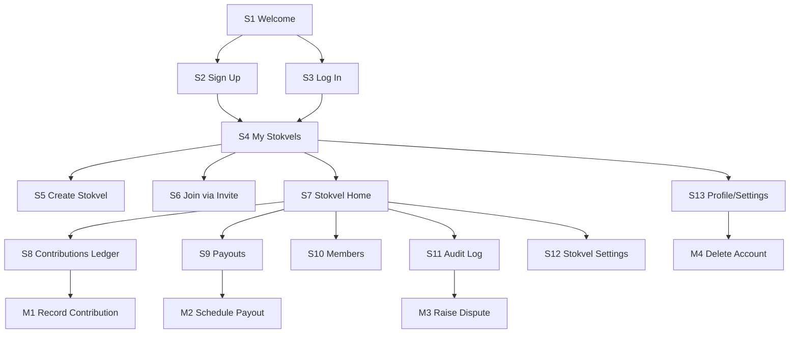

# PRD — StokvelOS

Oct 27, 2026 · @Melsoft

## Document details

| Field | Answer |
|---|---|
| Product name | StokvelOS |
| Author(s) | Thami Sithole |
| Course code and cohort | AISD - SNPL2026 |
| Facilitator / reviewer | Mnelisi Maswanganyi |
| Link to your original app idea | BUSINESS.md in the repository |
| GitHub repository | https://github.com/ThamiSithole/stokvelos |
| Version | v0.7 |
| Status | Draft |

### Change log

| Version | Date | Section(s) changed | What changed | Regenerated? (screens / MASTER.md / none) |
|---|---|---|---|---|
| v0.7 | 2026-11-25 | 1.4, 1.5, 3.2, 4.1–4.4, 5, 6.2, 8.1–8.4, 12–15, Document details | Made v1 explicitly a responsive, desktop-first web application; dropped F8/PWA/offline and their stories, rules, states and glossary term; added a deferred native-mobile/PWA rollout; updated navigation shell and exact acceptance wording | Screens to be re-exported from the external Stitch project (Phase B) |
| v0.6 | 2026-11-23 | 2.4, 2.5, 5, 8.1, 11, 14, Document details | Closed all five plan-only clarifications: Platform Admin is an `is_admin` boolean with no v1 screen (C2); English-only i18n-ready with all 12 SA official languages as a future feature (C12); Workbox read-only offline cache (C13); service-role key local-scripts-only (C15); Google OAuth included in v1 Phase 2 while Storage stays client-side (C17) | S2, S3 (Google button) |
| v0.5 | 2026-11-23 | 8.1, 12, Document details | Added the resolved S2 privacy-link target: in-app `/privacy` POPIA policy page; §12 now records the policy location and indefinite anonymised audit retention | None |
| v0.4 | 2026-11-23 | 4.5, Document details | Human-confirmed Stitch design answers: notification "New member joined" target corrected from S5 to S4 (C10); all answers recorded in `docs/designs/STITCH_PROMPTS.md` "Resolved design decisions" | None |
| v0.3 | 2026-11-23 | 4.1, 8.1, Document details | Corrected feature-to-story mapping: US13 (resolve a dispute) belongs to F5, not F6; F6 now traces to §4.5 Notifications; added F6 to the S7/S9/S13 feature lists | None |
| v0.2 | 2026-11-23 | 2.5, 4.1, 4.5, 6.1, 14, Document details | Aligned format to the Indlela PRD standard; corrected feature-to-screen mapping (F1–F7) against implementation plan §7.3/§13; clarified US2 landing state; mapped open questions to implementation plan §18 | None |
| v0.1 | 2026-11-23 | All | First draft | None |

## 1. Product overview

**1.1 Product name:** StokvelOS

**1.2 One-line pitch:** StokvelOS gives stokvels a shared, tamper-evident ledger and payout scheduler, so every member always knows where their money is.

**1.3 Problem statement:** Stokvels move an estimated R50bn+ per year for millions of low- and middle-income South African households, but they run on WhatsApp groups and memory. Treasurers track contributions in notebooks or Excel, payouts are scheduled by hand, and there is no shared record. Disputes over who paid, how much, and who is next in the rotation are frequent and erode trust; a single missed or late payout can collapse a group and cost members savings earmarked for school fees, groceries or funeral costs.

**1.4 Solution:** StokvelOS is a responsive, desktop-first web application that gives a stokvel a shared ledger: create a group, invite members, record contributions, schedule and track payouts, and keep an immutable audit trail. It stays light on data; no money is held by the app in v1 — it is a record-keeping and trust tool, not a bank.

**1.5 Platform:** Responsive web application in the browser, desktop-first at 320 / 768 / 1024 / 1440 breakpoints: left sidebar at ≥1024px, compact icon rail at 768–1023px, bottom nav below 768px. No native iOS/Android app, no installable PWA, no service worker and no offline cache in v1 — these are deferred to a later mobile rollout (§3.2, §4.3; ADR-0001).

**1.6 Vision:** To make transparent, tamper-evident record-keeping the default for stokvels across South Africa's most trust-constrained communities.

**1.7 Key terms:**

| Term | Exact meaning in this app |
|---|---|
| Stokvel | A rotating savings & credit association (group of members saving together on a fixed cycle) |
| Organizer (Treasurer) | The member who creates and administers a stokvel group |
| Member | A participant in a stokvel group |
| Contribution | A recorded payment by a member for a given cycle/period |
| Payout | A scheduled or completed payment out to a member per the rotation order |
| Cycle | One full rotation in which every member receives one payout |
| Audit log | Immutable record of every change to a stokvel's data (who, what, when, before/after) |
| Dispute | A member-raised question about a contribution or payout, resolved by the organizer |

## 2. Users, personas and roles

**2.1 Primary user:** Stokvel treasurer/organizer, aged 25–55, managing 1–5 groups of 10–50 members. Tech comfort: Medium. Uses a desktop browser to administer groups and an Android phone on prepaid data; uses WhatsApp daily. Often female; community leader.

**2.2 Secondary user:** Stokvel members wanting transparency on their own contributions and next payout. Tech comfort: Low–Medium.

**2.3 Personas**

| Field | Persona 1 | Persona 2 |
|---|---|---|
| Name and age | Nomsa Dlamini, 42 | Sipho Nkosi, 30 |
| Role | Organizer/Treasurer | Member |
| Situation | Runs 2 stokvels (15 + 28 members) in Soweto; teacher by day | Member of a 20-person burial stokvel in Tembisa; works in retail |
| Device/connectivity | Desktop + Android, prepaid data, WhatsApp | Desktop or Android, prepaid data, WhatsApp |
| Tech comfort | Medium | Low–Medium |
| Language(s) | English, isiZulu, Setswana, Sesotho | English, isiZulu, Setswana, Sesotho |
| Goal | Stop disputes, save admin time, keep members | Know what he has paid and when his payout is due |
| Frustrations today | Notebook lost once; members argue about who paid; chasing late payers | Never sure of his balance; feels treasurer has too much power |
| How app helps | Shared ledger + audit trail; automated reminders | Member statement + payout schedule; can raise a dispute |
| Quote | "I need everyone to see the same book." | "I just want to know my money is safe." |

**2.4 Roles and permissions**

| Role | How someone gets it | Can do | Cannot do |
|---|---|---|---|
| Member | Accepts an invite link | View own + group ledger, contribution history, payout schedule, raise a dispute | Create/edit stokvel, record contributions, schedule/mark payouts, resolve disputes, remove members |
| Organizer (Treasurer) | Creates a stokvel (becomes organizer); or promoted by an organizer | Everything a Member can, plus: create/edit stokvel settings, invite/remove members, record contributions, schedule & mark payouts, resolve disputes | Access other stokvels' data; platform-wide admin |
| Platform Admin | `is_admin` boolean on `profiles`, set only in Supabase (§18 C2) | Moderate, view aggregate stats, suspend abusive accounts | Read member financial data beyond aggregates; impersonate users |

**2.5 Platform Admin:** Platform Admin work is done directly in the database (Supabase) in v1; there are no admin screens in the app. The role is an `is_admin` boolean on `profiles`, set only by a database administrator (implementation plan §18 C2 closed). Do not build a moderation UI.

## 3. Goals, success metrics and non-goals

**3.1 Goals**

| # | Goal | Metric | Target | How you will check it |
|---|---|---|---|---|
| G1 | Reduce stokvel disputes | % of groups with ≥1 open dispute at any time | ≤ 10% of active groups | Count Dispute rows with status=open |
| G2 | On-time payouts | % of payouts marked paid on or before scheduled_date | ≥ 90% | Payout status vs scheduled_date |
| G3 | Member retention | % of members still active after 6 months | ≥ 85% | StokvelMember status over time |
| G4 | Treasurer time saved | Self-reported admin hours/week | Down ≥ 60% | Post-use survey (5 treasurers) |
| G5 | Adoption | Active stokvels | ≥ 20 in first 3 months | Count stokvels with ≥1 contribution recorded |

**3.2 Non-goals**

- Holding or moving money: no custody of funds in v1 (record-keeping only; payouts recorded, not executed).
- Full banking/interest/lending products.
- Native mobile apps (iOS/Android), installable PWA, service worker and offline caching — deferred to a later mobile rollout (ADR-0001).
- Multi-currency or cross-border stokvels.
- Automated bank reconciliation / payment gateway payouts (v2).
- Push notifications at scale (in-app + WhatsApp share links in v1).

## 4. Features, business rules and notifications

**4.1 Feature list**

| ID | Feature name | What the user can do | Priority | Goal | Stories | Screens |
|---|---|---|---|---|---|---|
| F1 | Accounts & roles | Sign up, log in, log out, set profile | Must | G3,G5 | US1,US2,US3 | S1,S2,S3,S13 |
| F2 | Stokvel groups | Create group, edit settings, invite via link/WhatsApp, join, view member list, remove member | Must | G5 | US4,US5,US6 | S4,S5,S6,S10,S12,M5,M7 |
| F3 | Contributions ledger | Record contribution, view group ledger, view member statement, balances per cycle | Must | G1,G2,G4 | US7,US8 | S7,S8,M1 |
| F4 | Payout schedule & tracking | Set rotation order, schedule payouts, mark paid, view upcoming payouts, reminders | Must | G2,G4 | US9,US10 | S9,M2,M6 |
| F5 | Audit & dispute log | View immutable change log, raise dispute, resolve dispute (organizer) | Must | G1,G3 | US11,US12,US13 | S11,M3 |
| F6 | Reminders & notifications | In-app reminders for upcoming payouts/late contributions | Should | G2,G4 | §4.5 (Notifications) | S7,S9,S13 |
| F7 | Export & reports | Export group ledger to PDF/CSV | Should | G4 | US14 | S7,S13 |

Offline caching, installable PWA support and native mobile apps are deferred to a later mobile rollout (ADR-0001); they are not in v1.

**4.2 MVP definition:** The smallest version is StokvelOS with F1–F5 (accounts, groups, contributions, payouts, audit/disputes). F6–F7 are polish.

**4.3 Future features:** Payment gateway payouts, bank reconciliation, multi-group dashboards, stokvel association white-label, push notifications, and a later mobile rollout (native iOS/Android apps and PWA/offline support — ADR-0001).

**4.4 Business rules**

| ID | Rule | Used by |
|---|---|---|
| BR1 | A stokvel must have ≥ 2 members and ≤ 200 members. | F2 |
| BR2 | Only the organizer can record contributions, schedule/mark payouts, edit settings, invite/remove members, resolve disputes. | F2,F3,F4,F5 |
| BR3 | A member can only raise a dispute on contributions/payouts in groups they belong to. | F5 |
| BR4 | Contribution amount must be > 0 and ≤ 1,000,000 ZAR. | F3 |
| BR5 | Payout amount must be > 0 and ≤ 10,000,000 ZAR. | F4 |
| BR6 | An invite link expires after 7 days or when used (single-use) — configurable by organizer (reusable toggle). | F2 |
| BR7 | A member cannot be removed if they have an unpaid payout scheduled in the current cycle; organizer must reassign first. | F2,F4 |
| BR8 | Audit log entries are immutable: no update or delete permitted (DB-level). | F5 |
| BR9 | Audit log entries are written only by database triggers, never by app code. | F5 |
| BR10 | A dispute can only be resolved by the organizer of that stokvel. | F5 |
| BR11 | Payout schedule order is set by organizer; defaults to join order. | F4 |
| BR13 | A user may belong to multiple stokvels. | F1,F2 |

**4.5 Notifications**

| Trigger | Who receives | Channel | Exact text | Opens |
|---|---|---|---|---|
| Payout due within 3 days | Organizer + recipient member | In-app | "Payout due for [Member] on [Date]." | S9 |
| Contribution overdue (cycle closed, member unpaid) | Organizer + member | In-app | "[Member] has not contributed for [Period]." | S7 |
| New member joined | Organizer | In-app | "[Name] joined [Stokvel]." | S4 |
| Dispute raised | Organizer | In-app | "New dispute raised in [Stokvel]." | S13 |
| Dispute resolved | Raising member | In-app | "Your dispute in [Stokvel] was resolved." | S13 |

## 5. Accounts and sign-in

| Decision | Answer |
|---|---|
| Sign-up methods | Email + password (Supabase Auth) and Google OAuth — both in v1; OAuth is built in Phase 2 (§18 C17). Age and privacy consent apply to both. |
| Who may sign up | Anyone 18+ with an email address |
| Minimum age | 18 with confirmation checkbox |
| Password rules | At least 8 characters, including at least 1 number |
| Forgot password | Available (Supabase reset flow) |
| Failed log-in attempts | Handled by Supabase (rate limiting) |
| Stay logged in | 30 days (refresh token) |
| Log out | Available from Profile/Settings |
| Delete account | Available in v1 (removes profile; audit log retained anonymised) |

## 6. User stories, acceptance criteria and edge cases

**6.1 Stories**

**US1:** As a new user, I want to create an account.  
T-US1-1: Given valid email and password (8+ chars, 1 number) and age confirmation, account created and I am logged in.

**US2:** As a user, I want to log in.  
T-US2-1: Given correct credentials, I go to S4 (My Stokvels). If I have no stokvels, S4 shows the empty state with Create and Join CTAs.

**US3:** As a user, I want to log out.  
T-US3-1: Session cleared; redirected to S1.

**US4:** As an organizer, I want to create a stokvel.  
T-US4-1: Given name, contribution amount, frequency, a stokvel is created and I am its organizer.

**US5:** As an organizer, I want to invite members.  
T-US5-1: A shareable link (and WhatsApp share) is generated; recipient can join within 7 days (BR6).

**US6:** As a user, I want to join a stokvel via invite.  
T-US6-1: Given a valid, unexpired invite, I become a member.

**US7:** As an organizer, I want to record a contribution.  
T-US7-1: Given member, amount, period, contribution is saved and audit log entry created.

**US8:** As a member, I want to view my statement.  
T-US8-1: I see my contributions, payouts received, and current balance for the stokvel.

**US9:** As an organizer, I want to set the payout rotation.  
T-US9-1: I can order members; order saved and used for scheduling.

**US10:** As an organizer, I want to schedule and mark a payout.  
T-US10-1: Given member + amount + date, payout created; marking paid records paid_at and audit log entry.

**US11:** As a member, I want to view the audit log.  
T-US11-1: I see a chronological list of changes with actor, action, before/after.

**US12:** As a member, I want to raise a dispute.  
T-US12-1: Given subject + description, dispute created (status open) and organizer notified.

**US13:** As an organizer, I want to resolve a dispute.  
T-US13-1: Given resolution note, dispute marked resolved with resolver + timestamp.

**US14:** As an organizer, I want to export the ledger.  
T-US14-1: PDF/CSV download of contributions + payouts for the stokvel.

**6.2 Edge cases**

| Situation | What the user sees | What the app does |
|---|---|---|
| Invite expired | "This invite has expired. Ask the organizer for a new link." | Join blocked |
| Invite already used (single-use) | "This invite has already been used." | Join blocked |
| Duplicate contribution for same period | "A contribution for [Member] for [Period] already exists. Edit instead?" | Prevent duplicate; offer edit |
| Member with scheduled unpaid payout removed | "Cannot remove: [Member] has an unpaid payout. Reassign first." | Block removal (BR7) |
| Contribution amount invalid | "Amount must be between R0.01 and R1,000,000." | Block save (BR4) |
| Network request fails | "No connection." | Show error state; no cached-data fallback in v1 |
| Slow response / timeout | "Couldn't load. Try again." | Show retry action |
| Non-organizer tries organizer action | "Only the organizer can do this." | 403 / RLS blocks |
| Audit log tamper attempt | N/A (no UI) | DB blocks update/delete (BR8) |

## 7. User flows and navigation map

**Flow 1:** Onboarding → Sign Up → Log In → My Stokvels → Create/Join  
**Flow 2:** Stokvel → Record Contribution → Success  
**Flow 3:** Stokvel → Schedule Payout → Mark Paid  
**Flow 4:** Stokvel → Audit Log → Raise Dispute → Resolve  
**Flow 5:** Profile → Export Ledger

**Navigation:** Bottom nav on S4,S5,S6,S7,S8,S9,S10,S11,S12,S13: Home (My Stokvels), Ledger, Payouts, Audit, Profile. Top app bar with back button on detail screens.

## 8. Screens, modals and UI states

**8.1 Screen list**

| ID | Screen name | Purpose | Primary action | Features | Notes |
|---|---|---|---|---|---|
| S1 | Welcome | Entry point | Sign up or Log in | F1 | Logo + pitch + 2 buttons; low-data |
| S2 | Sign Up | Create account | Register (email or Google) | F1 | Email, password, age checkbox, privacy checkbox linking to `/privacy`, "Continue with Google" button |
| S3 | Log In | Authenticate | Log in (email or Google) | F1 | Email, password, forgot password link, "Continue with Google" button |
| S4 | My Stokvels | List of user's stokvels | Open / Create | F1,F2 | Empty state with Create + Join CTAs |
| S5 | Create Stokvel | Create a new group | Create | F2 | Name, description, amount, frequency, rotation default |
| S6 | Join via Invite | Accept invite | Join | F2 | Shows stokvel preview + Join button |
| S7 | Stokvel Home | Group overview | View summary | F2,F3,F4,F6 | Balance, next payout, recent activity, quick actions |
| S8 | Contributions Ledger | Record + view contributions | Record contribution | F3 | Table by member × period; totals; member filter |
| S9 | Payouts | Schedule + track payouts | Schedule payout | F4,F6 | Rotation order, upcoming, mark paid, history |
| S10 | Members | Member list + roles | Invite / remove | F2 | Role badges, join dates, remove (organizer) |
| S11 | Audit Log | Immutable change history | View / raise dispute | F5 | Chronological feed; dispute action per entry |
| S12 | Stokvel Settings | Edit group settings | Save | F2 | Name, amount, frequency, rotation, delete group |
| S13 | Profile/Settings | User settings | Save | F1,F6,F7 | Name, phone, export, logout, delete account |

**Modals**

| ID | Modal name | Trigger | Purpose |
|---|---|---|---|
| M1 | Record Contribution | S8 → "Record" | Form: member, amount, period, note |
| M2 | Schedule Payout | S9 → "Schedule" | Form: member, amount, date, note |
| M3 | Raise Dispute | S11 → "Raise dispute" | Form: subject, description |
| M4 | Delete Account | S13 → "Delete account" | Confirm permanent deletion |
| M5 | Invite Member | S10 → "Invite" | Show link + WhatsApp share + copy |
| M6 | Mark Payout Paid | S9 → "Mark paid" | Confirm + paid_at + note |
| M7 | Remove Member | S10 → "Remove" | Confirm (blocked if unpaid payout — BR7) |

**8.2 Key UI states per important screen**

| Screen | Normal | Empty | Loading | Error | Success |
|---|---|---|---|---|---|
| S1 Welcome | Logo, pitch, Sign up + Log in | N/A | N/A | N/A | N/A |
| S2 Sign Up | Form valid → button enabled | N/A | Spinner on button | "This email already has an account." / "No connection."; red border on password rules | Created → S3 banner |
| S3 Log In | Form | N/A | Spinner | "Invalid credentials." / "Please verify email." / "No connection." | Verified → S4 |
| S4 My Stokvels | List of stokvel cards | "You're not in any stokvel yet. Create one or join with a link." + 2 CTAs | Spinner | "Couldn't load. Try again." | N/A |
| S5 Create Stokvel | Form | N/A | Spinner on Create | Validation errors inline / "No connection." | Created → S7 |
| S6 Join via Invite | Preview card + Join | "Invite expired/used" | Spinner | "Couldn't join. Try again." / "No connection." | Joined → S7 |
| S7 Stokvel Home | Summary cards | N/A (group exists) | Spinner | "Couldn't load. Try again." | N/A |
| S8 Contributions | Table + totals | "No contributions yet. Record the first one." | Spinner | "Couldn't load. Try again." | "Contribution recorded." |
| S9 Payouts | Rotation + upcoming + history | "No payouts scheduled yet." | Spinner | "Couldn't load. Try again." | "Payout scheduled/marked paid." |
| S10 Members | Member list | "No members yet. Invite someone." | Spinner | "Couldn't load. Try again." | "Member joined/removed." |
| S11 Audit Log | Chronological feed | "No activity yet." | Spinner | "Couldn't load. Try again." | N/A |
| S12 Settings | Form | N/A | Spinner on Save | Validation errors / "No connection." | "Saved." |
| S13 Profile | Settings | N/A | Spinner on Save | "Couldn't save." / "No connection." | "Saved." |
| M1–M7 | Forms | N/A | Spinner on submit | Inline errors / "No connection." | Success toast → close |

**8.3 Shared components**

| Component | Variants / states | Used by |
|---|---|---|
| Button | Primary, secondary, ghost, destructive, disabled, loading | All |
| TextInput | Default, focused, error, disabled | S2,S3,S5,S12,S13,M1–M4 |
| Card | Stokvel card, stat card, member row | S4,S7,S10 |
| Table | Contributions (member × period) | S8 |
| Badge | Role (organizer/member), status (paid/scheduled/overdue) | S9,S10 |
| Banner | Alert, info, error, success | All |
| Modal/Dialog | Form modal, confirm modal | M1–M7 |
| Empty state | Icon + message + CTA | S4,S8,S9,S10,S11 |
| Spinner | Small inline, large full-screen | All |
| Top app bar | Title, back, optional action | All detail screens |
| App nav | Sidebar ≥1024px, compact icon rail 768–1023px, bottom nav <768px; 5 destinations: Home, Ledger, Payouts, Audit, Profile | S4,S7,S8,S9,S10,S11,S13 |

**8.4 Accessibility**

- WCAG AA contrast minimum for all text.
- Tappable targets ≥ 44×44px.
- Labels on all inputs; error messages associated.
- Body text minimum 14px.
- Low-data: minimal images and no heavy animations; no cached/offline fallback in v1.
- Respect `prefers-reduced-motion`.

## 9. Design values

**9.1 Color palette**

| Token | Hex | Usage |
|---|---|---|
| Primary | #1b5e20 | Primary buttons, links, active nav tab, success |
| Primary light | #2e7d32 | Hover, secondary emphasis |
| Secondary | #f9a825 | Warm accent, highlights, reminders |
| Background | #fafafa | Screen background |
| Surface | #ffffff | Cards, inputs, modals |
| Text primary | #1a1a1a | Headings, body |
| Text secondary | #5f6368 | Captions, hints |
| Error | #c62828 | Errors, destructive |
| Success | #2e7d32 | Paid, success states |
| Warning | #f9a825 | Stale, overdue |
| Border | #e0e0e0 | Input borders, dividers |
| Disabled | #bdbdbd | Disabled elements |

**9.2 Typography**

| Style | Size / Line height | Weight | Usage |
|---|---|---|---|
| H1 | 24px / 32px | Bold (700) | Screen titles |
| H2 | 20px / 28px | Semibold (600) | Section headers |
| H3 | 16px / 24px | Semibold (600) | Card titles |
| Body | 14px / 20px | Regular (400) | Body text |
| Caption | 12px / 16px | Regular (400) | Hints, timestamps |
| Button | 14px / 20px | Medium (500) | Button labels |
| Input | 14px / 20px | Regular (400) | Input text |

Font family: Inter, system-ui fallback.

**9.3 Spacing**

| Token | Value | Usage |
|---|---|---|
| xs | 4px | Tight gaps |
| sm | 8px | Related elements |
| md | 16px | Standard padding, card margins |
| lg | 24px | Section spacing |
| xl | 32px | Screen-level padding |
| Touch target | 44px minimum | All tappable elements |

**9.4 Iconography**

- Style: Lucide / Heroicons outlined.
- Size: 24px default, 20px compact.
- Color: Text primary default; Primary for active.

**9.5 Logo**

The chosen logo concept is **R2-B "Refined ledger"** — three bold ruled ledger lines with one highlighted payout column and a subtle inward cycle arc. It is a one-colour, reversed-safe combination mark that works at 16px. The full kit and exports are in `docs/brand/kit/` (symbol, small, reversed, colour, wordmark, horizontal and stacked lockups), with guidelines at `docs/brand/kit/BRAND_GUIDELINES.md` and palette at `docs/brand/kit/palette.md`. The mark uses the PRD primary (#1B5E20) and secondary (#F9A825) tokens from §9.1. The wordmark text must be outlined to paths before final delivery.

## 10. Data model

| Entity | Fields | Relations | Notes |
|---|---|---|---|
| Profile | id (uuid, PK, =auth.users.id), full_name, phone, avatar_url, created_at | belongs to auth user | Created via trigger on signup |
| Stokvel | id, name, description, contribution_amount (numeric), contribution_frequency (weekly/monthly), currency (default ZAR), rotation_order (jsonb array of member ids), created_by (FK Profile), created_at, updated_at | has many StokvelMember, Contribution, Payout, Dispute, AuditLog | Max 200 members (BR1) |
| StokvelMember | id, stokvel_id (FK), user_id (FK Profile), role (organizer/member), status (active/invited/removed), joined_at | belongs to Stokvel, Profile | Unique (stokvel_id, user_id) |
| Invitation | id, stokvel_id (FK), token (unique), invited_by (FK Profile), invited_email (nullable), expires_at, accepted_at, reusable (bool) | belongs to Stokvel | BR6 |
| Contribution | id, stokvel_id (FK), member_id (FK StokvelMember), amount (numeric), period_label (text), note, recorded_by (FK Profile), recorded_at | belongs to Stokvel, StokvelMember | BR4; unique (stokvel_id, member_id, period_label) suggested |
| Payout | id, stokvel_id (FK), member_id (FK StokvelMember), amount (numeric), scheduled_date (date), status (scheduled/paid/cancelled), paid_at (nullable), recorded_by (FK Profile), note | belongs to Stokvel, StokvelMember | BR5,BR7 |
| Dispute | id, stokvel_id (FK), raised_by (FK Profile), subject_type (contribution/payout/stokvel), subject_id (uuid), description, status (open/resolved), resolved_by (FK Profile, nullable), resolved_at (nullable), resolution_note (nullable) | belongs to Stokvel | BR10 |
| AuditLog | id, stokvel_id (FK), actor_id (FK Profile), action (text), entity_type (text), entity_id (uuid), before (jsonb, nullable), after (jsonb, nullable), created_at | belongs to Stokvel | Immutable (BR8); written only by DB triggers (BR9) |

**RLS (permission rules enforced on backend):**
- Profile: user can read/update own row only.
- Stokvel: readable by its members; writable only by its organizer.
- StokvelMember: readable by members of that stokvel; insert/delete only by organizer (with BR7 guard).
- Invitation: readable by organizer; join via RPC validates token + expiry.
- Contribution/Payout/Dispute: readable by members of that stokvel; write (insert/update/delete) only by organizer (except Dispute insert by any member of the stokvel).
- AuditLog: readable by members of that stokvel; no insert/update/delete from app (triggers only).

## 11. APIs / integrations

| Integration | Purpose | Method | Auth | Required |
|---|---|---|---|---|
| Supabase Auth | Authentication | SDK | Keys | Yes |
| Supabase Postgres + RLS | Data storage & permission rules | SDK/REST | Keys + RLS | Yes |
| Supabase Storage | Not used in v1 (§18 C17 closed) | — | — | No — export is generated client-side |
| PayFast / Yoco | Transaction fees on payouts (v2) | REST | Keys | No (v2) |
| WhatsApp share | Invite sharing | Deep link (wa.me) | None | Yes |

## 12. Permissions, privacy and security

| Item | Answer |
|---|---|
| Data collected | Name, phone, email, stokvel membership, contributions, payouts, disputes |
| Permissions | None required in v1 (browser web app; no install or device permissions) |
| Security | Supabase RLS on every table, password hashing, data minimisation, audit log immutable |
| Privacy | POPIA policy published in-app at `/privacy`; age gate 18+, delete account supported (profile removed; audit log retained anonymised indefinitely), no custody of funds |
| Financial regulation | Positioned as record-keeping tool, not a bank; no money held or moved in v1 |

## 13. Build plan, milestones and MVP cut

**Milestones:**
- M1 Setup (repo, Next.js, Supabase, auth, CI, tests skeleton)
- M2 Groups (create/join/invite/members) + RLS
- M3 Contributions ledger + member statements
- M4 Payouts (rotation, schedule, mark paid)
- M5 Audit log + disputes
- M6 Polish (reminders, export, responsive web layout, a11y)
- M7 Test, deploy, README, Loom

**MVP cut:** Must have F1–F5. F6–F7 are polish (do if time).

## 14. Testing, acceptance and open questions

**Acceptance (Must features work end-to-end on live link):**
- Sign up/login works; organizer vs member roles enforced on backend (RLS).
- Create stokvel, invite via link, join as member.
- Record contributions; ledger + member statement correct.
- Schedule rotation, schedule payout, mark paid; audit log entry created.
- Raise + resolve dispute; audit log immutable.
- Responsive desktop-first web app at 320/768/1024/1440 (sidebar ≥1024, rail 768–1023, bottom nav <768); low-data; no placeholder screens.
- CI runs lint, typecheck, tests, build on every PR.

**Open questions:** (tracked in Section 18 of the implementation plan)

- Payment gateway for transaction fees (v2) — PayFast vs Yoco. Deferred with payment-gateway payouts (implementation plan §3.3); no v1 decision needed.
- Mobile rollout (native apps / PWA / offline cache) — Deferred (ADR-0001): not in v1; the former C13 Workbox decision is superseded. No open question for v1.
- Vernacular languages — Closed (C12): English only in v1 with an i18n-ready string structure. All 12 South African official languages are a future feature, subject to a separate i18n budget.
- Where the five §4.5 notification banners appear — Closed (C10): S9, S7, S4, S13, S13.
- How the Platform Admin role is stored — Closed (C2): an `is_admin` boolean on `profiles`; no moderation screen in v1.
- Google OAuth — Closed (C17): included in v1, built in Phase 2 alongside email + password. Supabase Storage is not used; export stays client-side.

Full clarification register: implementation plan §18 (C1–C17). Do not guess answers to Open items.

## 15. Glossary

| Term | Definition |
|---|---|
| Stokvel | Rotating savings & credit association |
| Organizer (Treasurer) | Creates and administers a stokvel |
| Member | Participant in a stokvel |
| Contribution | Recorded payment for a cycle |
| Payout | Scheduled/completed payment out per rotation |
| Cycle | One full rotation where every member receives one payout |
| Audit log | Immutable record of changes |
| Dispute | Member-raised question about a contribution/payout |
| RLS | Row-Level Security (Supabase/Postgres permission rules) |
| Mobile rollout | Deferred phase for native iOS/Android apps, installable PWA and offline support (ADR-0001) |

## 16. Appendix

Original business idea: [BUSINESS.md](../BUSINESS.md)  
Prior project (portfolio, separate repo — not this one): Indlela — transport affordability for job seekers (https://github.com/ThamiRoneo/indlela-mvp).  
Logo kit: docs/brand/kit/ (R2-B Refined ledger). Brand guidelines: docs/brand/kit/BRAND_GUIDELINES.md.  

Related: [[Home]]
